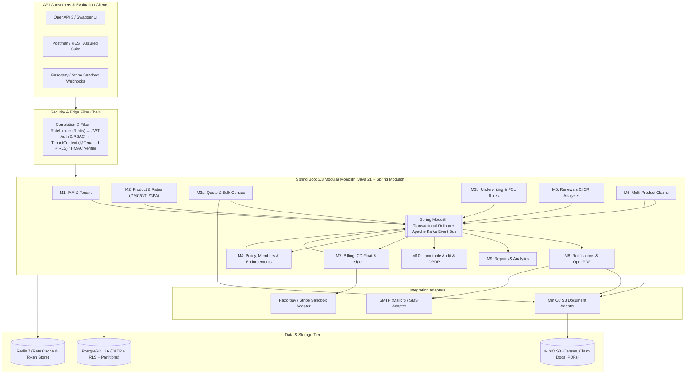
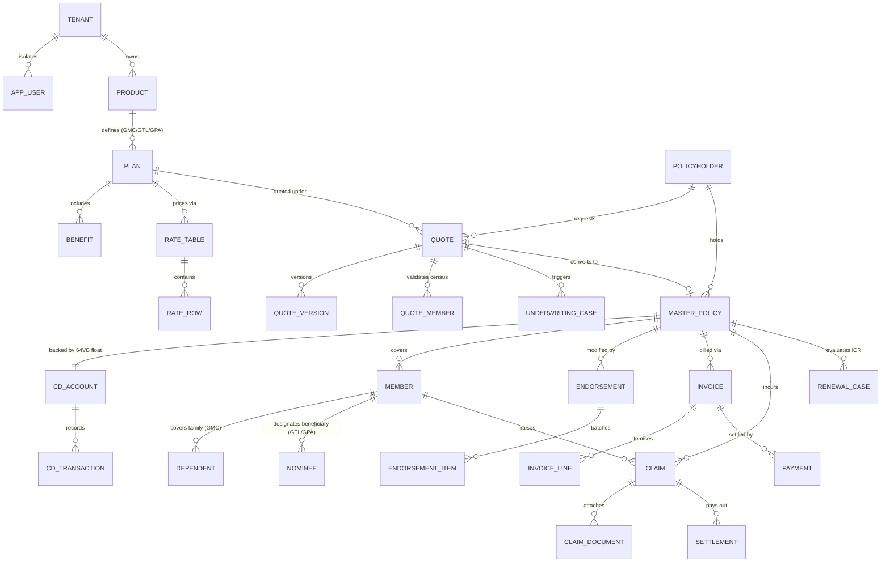
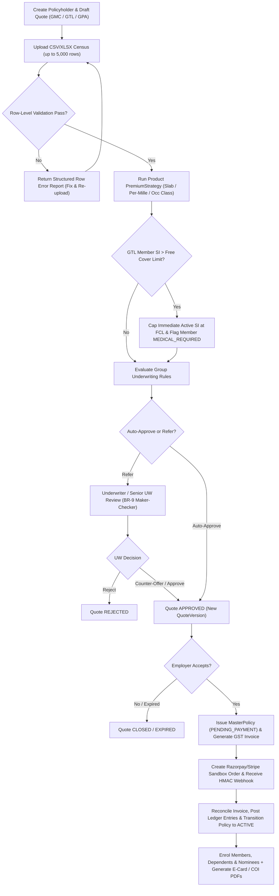
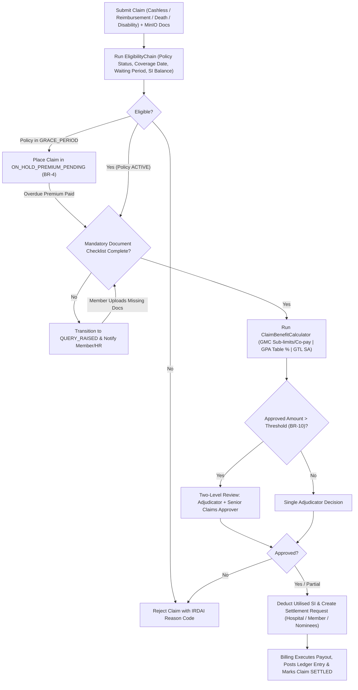
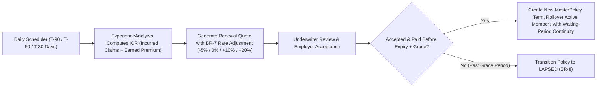

# InsureEase: InsureGroup Management Platform

**Product Requirements Document (PRD) | Version 1.1 | Multi-Tenant SaaS | Java 21 & Spring Boot 3.x Backend**  
**Project Type:** HCLTech Internship Project | **Author:** Nitin Chugh | **Date:** October 2026 | **Status:** Approved (v1.1 Refined)

---

## 1. Document Control

| Field | Detail |
| :--- | :--- |
| **Product Name** | InsureEase – InsureGroup Management Platform |
| **Version** | 1.1 (Refined for Multi-Product Day-1 Scope, Backend-First API Delivery & Live Payment Sandbox) |
| **Delivery Model** | Multi-tenant Headless SaaS (REST APIs + OpenAPI 3 / Swagger UI; SPA Portal in Phase 2) |
| **Primary Stack** | Java 21 (LTS), Spring Boot 3.x, Spring Modulith, Spring Data JPA (Hibernate 6), Spring Security (JWT/OAuth2), PostgreSQL 16 (with RLS), Redis, Apache Kafka, MinIO (S3), Razorpay/Stripe Sandbox |
| **Supported Product Lines** | Group Health (`GMC`), Group Term Life (`GTL`), Group Personal Accident (`GPA`) |
| **Audience** | Mentors, evaluators, backend engineers, QA, DevOps |
| **Related Artefacts** | ERD, Flow Diagrams, DRD (Data Requirements), HLD, LLD, Architecture Diagrams, OpenAPI 3.1 Spec |

---

## 2. Executive Summary

Group insurance covers a cohort of people under a single master policy purchased by an organisation (employer, association, bank, NBFC, or institution). In the Indian insurance ecosystem, insurers, brokers, and Third-Party Administrators (TPAs) still manage significant portions of group business across spreadsheets, email threads, and disconnected legacy systems. This causes slow census onboarding, manual and error-prone rating across multiple product lines, delayed mid-term member endorsements, compliance risks under Section 64VB, long claim turnaround times (TAT), and poor renewal loss-ratio visibility.

**InsureEase** is a cloud-ready, multi-tenant, API-first SaaS backend platform that digitises the complete group-insurance lifecycle across **Group Health (GMC)**, **Group Term Life (GTL)**, and **Group Personal Accident (GPA)** in one unified system:

1. **Product & Rate Configuration:** Multi-product plans, slab/per-mille/occupation-class rate cards, Free Cover Limits (FCL), benefits, sub-limits, co-pay, and waiting periods.
2. **Underwriting & Quotation:** Bulk census validation, multi-strategy premium calculation, automated risk rules (including GTL Free Cover Limit referrals), maker-checker approvals, and quote versioning.
3. **Policy Administration:** Master policy issuance, member/dependent/nominee enrolment, digital certificates/e-cards, and mid-term endorsements backed by Section 64VB Cash Deposit (CD) accounts or invoice gates.
4. **Renewals:** Automated expiry tracking (T-90/60/30), experience-based Incurred Claims Ratio (ICR) re-rating, and seamless member rollover.
5. **Claims Management:** Multi-product claim intake (Cashless, Reimbursement, Death Benefit, Disability Benefit), eligibility verification chain, benefit/sub-limit calculation, two-level adjudication, and settlement triggers.
6. **Billing, CD Float & Payments:** GST-compliant invoicing, debit/credit notes, employer Cash Deposit (CD) float ledger, live Razorpay/Stripe test sandbox checkout & HMAC webhook reconciliation, and double-entry ledger entries.

---

## 3. Domain Research & Background

### 3.1 Key Domain Concepts

| Term | Meaning |
| :--- | :--- |
| **Master Policy** | The umbrella contract between the insurer and the group policyholder (employer/organisation). |
| **Certificate of Insurance (COI) / E-Card** | Evidence of cover issued to each enrolled employee/member under the master policy. |
| **Member / Dependent / Nominee** | Covered primary employee (`Member`), their covered family (`Dependent` in GMC), and designated legal beneficiary (`Nominee` in GTL/GPA for death payouts). |
| **Census** | Structured employee & dependent roster (Employee Code, DOB, Gender, Relation, Sum Insured, Annual CTC, Occupation Class) uploaded for pricing and enrolment. |
| **Sum Insured (SI) / Sum Assured (SA)** | Maximum financial liability per member (`INDIVIDUAL`) or shared across a family unit (`FAMILY_FLOATER`). |
| **Free Cover Limit (FCL)** | Maximum Sum Assured in Group Term Life (`GTL`) granted automatically without individual medical underwriting. Cover above FCL requires medical evaluation. |
| **Occupation Risk Class** | Risk classification in Group Personal Accident (`GPA`): `CLASS_I` (white-collar/office), `CLASS_II` (field/supervision), `CLASS_III` (manual/hazardous labour). |
| **Cash Deposit (CD) Account** | Advance float balance maintained by the employer with the insurer to satisfy **Section 64VB (Cash Before Cover)** for instant mid-term member additions. |
| **Endorsement** | Mid-term policy modification (add joiners, delete leavers, revise SI on promotion, correct member data) with pro-rata premium adjustment. |
| **Experience Rating & ICR** | Renewal pricing driven by past claims performance. $\text{ICR (Loss Ratio)} = \frac{\text{Incurred Claims}}{\text{Net Earned Premium}} \times 100$. |
| **Cashless vs. Reimbursement** | Direct hospital settlement via pre-authorisation (GMC/GPA hospitalisation) vs. post-discharge reimbursement to the member. |
| **TPA** | Third-Party Administrator licensed by IRDAI to process health claims on behalf of insurers. |
| **Grace Period** | Configured period (default 30 days) after an instalment/renewal due date during which policy cover is conditionally held pending premium realisation. |

### 3.2 Supported Group Product Lines (Day-1 Scope)

| Product Dimension | Group Health (`GMC`) | Group Term Life (`GTL`) | Group Personal Accident (`GPA`) |
| :--- | :--- | :--- | :--- |
| **Insured Lives** | Employee + Dependents (`SPOUSE`, `CHILD`, `PARENT`) | Employee Only (`SELF`) | Employee Only (`SELF`) |
| **Coverage Basis** | `INDIVIDUAL` or `FAMILY_FLOATER` | `INDIVIDUAL` | `INDIVIDUAL` |
| **SI Determination** | Flat Slab or Grade-Linked (e.g., ₹3L, ₹5L, ₹10L) | Flat Slab or Salary Multiple (e.g., $3 \times \text{Annual CTC}$) | Flat Slab or Salary Multiple |
| **Primary Rate Unit** | Flat Rate (`₹`) per Age Band × SI Slab × Relation | **Per Mille** (`₹ per ₹1,000 SA`) by Age Band × Gender | **Per Mille** (`₹ per ₹1,000 SA`) by Occupation Risk Class |
| **Benefit Structure** | In-patient hospitalisation, room rent cap, ICU cap, maternity sub-limit, pre/post-hospitalisation, co-pay %, waiting periods | Lump-sum Death Benefit (100% SA) on natural or accidental death, terminal illness rider | **Table A:** Accidental Death (100% SA)<br>**Table B:** Permanent Total Disability (100% SA)<br>**Table C:** Permanent Partial Disability (% scale)<br>**Table D:** Temporary Total Disability (weekly indemnity) |
| **Payout Recipient** | Network Hospital (Cashless) or Member (Reimbursement) | Designated **Nominee(s)** (pro-rata by `share_pct`) | Member (Disability) or **Nominee(s)** (Accidental Death) |

### 3.3 Pain Points Addressed

1. **Spreadsheet Census Chaos:** Eliminates unvalidated Excel rosters with asynchronous streaming validation and detailed row-level error reporting.
2. **Multi-Product Pricing Fragmentation:** Unifies slab-based health pricing, per-mille mortality life pricing (with FCL caps), and occupation-class accident pricing into one strategy-driven engine.
3. **Section 64VB Endorsement Bottlenecks:** Automates pro-rata calculations and debits the policy's CD Float Account so new joiners get instant day-one coverage.
4. **Opaque Claims Adjudication:** Replaces email-based claim tracking with structured document checklists, automated eligibility chains, sub-limit/benefit calculators, and IRDAI SLA timers.
5. **Disconnected Billing & Ledger:** Links every policy issuance, endorsement debit/credit note, gateway webhook, and claim payout to an immutable double-entry ledger.
6. **Weak Multi-Tenant & DPDP Compliance:** Enforces row-level tenant isolation, PII field encryption/masking, consent logs, and immutable before/after audit trails.

### 3.4 Regulatory and Compliance Context (India Focus)

- **IRDAI Master Circular on Health Insurance Business (2024):**
  - Cashless pre-authorisation decision SLA: **1 hour**.
  - Final cashless discharge authorisation SLA: **3 hours**.
  - Standard reimbursement claim adjudication SLA: **15 days** from final document receipt.
  - Pre-Existing Disease (PED) maximum waiting period: **≤ 36 months** (configurable down to 0 days for group waivers).
- **Insurance Act, 1938 — Section 64VB (Cash Before Cover) & Section 39 (Nomination):**
  - Risk cannot commence without advance premium receipt or sufficient Cash Deposit (CD) float balance.
  - Mandatory nominee registration (with appointee details if nominee is a minor) for `GTL` and `GPA` policies.
- **Digital Personal Data Protection (DPDP) Act 2023:**
  - Explicit consent tracking per member, purpose limitation, PII/health data encryption at rest (AES-256-GCM), masked API responses/logs for Aadhaar/PAN/diagnosis, and right-to-erasure anonymisation workflows.
- **GST Compliance:**
  - Configurable GST calculation (18% standard on group insurance premiums, with CGST+SGST for intra-state and IGST for inter-state based on policyholder GSTIN state code).

---

## 4. Problem Statement, Vision & Goals

- **Problem:** Group insurance operations across Health, Life, and Accident lines are spreadsheet-driven, slow, error-prone, and poorly auditable.
- **Vision:** A single configurable, multi-tenant API platform where any group policy (`GMC`, `GTL`, `GPA`) moves seamlessly from census upload and underwriting to policy issuance, endorsement, claim settlement, and experience-rated renewal.

### 4.1 Goals & Target Metrics

| ID | Goal | Metric / Target |
| :--- | :--- | :--- |
| **G1** | Faster Onboarding | Bulk census of 5,000 members validated and persisted in **< 2 minutes** |
| **G2** | Accurate Multi-Product Pricing | Premium engine matches reference rate-card outputs across GMC, GTL, and GPA with **100% accuracy** (scale = 2, `HALF_UP` rounding) |
| **G3** | Shorter Claims TAT | Automated 5-step eligibility & sub-limit calculation reduces adjudication time by **40% vs. manual baseline** |
| **G4** | Renewal Readiness | Renewal quotes with experience-based ICR rate adjustments auto-generated at **T-90, T-60, and T-30 days** for 100% of eligible policies |
| **G5** | Complete Auditability | **100% of state transitions and entity mutations** captured in an immutable, partitioned audit log |
| **G6** | High Reliability & Performance | **99.5% availability**, p95 read API latency **< 500 ms** under concurrent load |

### 4.2 Non-Goals (v1 Scope Boundaries)

- **Frontend SPA UI:** v1 delivers a headless backend with interactive OpenAPI 3 / Swagger UI and automated Postman/REST Assured suites. React/Angular portals are Phase 2.
- **Live Hospital Core Integration:** Hospital network directory is seeded locally; external hospital HL7/NHCX exchange is mocked via adapter.
- **Real Money Movement:** Payment integration uses live **Razorpay / Stripe Test Sandboxes** (real API calls & HMAC webhooks using test keys, no real bank settlement).
- **Retail / Individual Policies & Reinsurance Treaty Accounting:** Out of scope.

---

## 5. Stakeholders and Personas

Even in a backend-first v1, every API endpoint and RBAC permission is designed around ten distinct personas:

| Persona | Role Code | Key API Capabilities |
| :--- | :--- | :--- |
| **Platform Admin** | `ROLE_PLATFORM_ADMIN` | Onboard insurer/TPA tenants, manage subscription plans, monitor system health |
| **Insurer Admin** | `ROLE_INSURER_ADMIN` | Configure products (`GMC`, `GTL`, `GPA`), plans, versioned rate tables, underwriting rules, and tenant users |
| **Underwriter** | `ROLE_UNDERWRITER` | Review referred quotes and over-FCL member cases, apply discretionary loadings/discounts, approve/reject/counter-offer (`BR-9` maker-checker) |
| **Policy Admin Officer** | `ROLE_POLICY_ADMIN` | Issue master policies, manage member certificates, review and approve mid-term endorsements |
| **Claims Officer / Adjudicator** | `ROLE_CLAIMS_OFFICER` | Review claims, verify uploaded documents, raise member queries, adjudicate payouts (`BR-10` two-level approval) |
| **Finance Officer** | `ROLE_FINANCE_OFFICER` | Manage invoices, CD float top-ups, manual NEFT/UTR receipts, gateway reconciliations, refunds, and claim payouts |
| **Broker / Agent** | `ROLE_BROKER` | Create employer profiles, upload census files, generate quotes, track policies and broker commissions |
| **Employer HR Admin** | `ROLE_EMPLOYER_HR` | Upload census, accept quotes, submit mid-term endorsements (joiners/leavers), top up CD account, view invoices & claims |
| **Member / Employee** | `ROLE_MEMBER` | View own coverage, download e-card/COI, manage dependents & nominees, submit and track claims |
| **Auditor / Compliance** | `ROLE_AUDITOR` | Read-only access to immutable audit trails, consent logs, and compliance reports |

---

## 6. Scope and Module Overview

| # | Module (`com.insureease.*`) | Summary | MVP Phase |
| :--- | :--- | :--- | :--- |
| **M1** | `iam` (Tenant & IAM) | Multi-tenancy (`INSURER`, `TPA`, `BROKER`), JWT + rotating refresh tokens, RBAC, password policy | **MVP (P0)** |
| **M2** | `product` (Product & Rate Config) | GMC, GTL, GPA plans, benefits, sub-limits, FCL, versioned rate tables, loadings/discounts | **MVP (P0)** |
| **M3** | `quote` & `underwriting` | Employer KYC profile, async CSV/XLSX census upload, multi-product premium engine, rule engine, UW workflow | **MVP (P0)** |
| **M4** | `policy` (Policy Administration) | Master policy lifecycle, member/dependent/nominee enrolment, COI/e-cards, mid-term endorsements | **MVP (P0)** |
| **M5** | `renewal` (Renewals) | T-90/60/30 expiry scheduler, ICR/loss-ratio analyzer, experience-rated renewal quote, rollover | **MVP (P0)** |
| **M6** | `claims` (Claims Management) | Multi-product FNOL intake, MinIO document upload, eligibility chain, benefit/sub-limit math, adjudication, settlement | **MVP (P0)** |
| **M7** | `billing` (Billing, CD & Payments) | GST invoices, debit/credit notes, CD float ledger, Razorpay/Stripe sandbox orders & webhooks, double-entry ledger | **MVP (P0)** |
| **M8** | `notification` (Notifications & Docs) | Event-driven email/SMS adapters, OpenPDF generation (Quote PDF, Policy Schedule, E-Card/COI, Tax Invoice) | **MVP Basic (P1)** |
| **M9** | `reporting` (Reports & Analytics) | Loss ratio (ICR) breakdown, claims TAT compliance, renewals pipeline, collections & CD statement exports | **MVP Basic (P1)** |
| **M10** | `audit` (Audit & DPDP Compliance) | Immutable monthly-partitioned audit log, DPDP consent ledger, PII masking, data anonymisation API | **MVP (P0)** |

---

## 7. Functional Requirements

*Priority levels: **P0** = Must-have for MVP, **P1** = Should-have for MVP, **P2** = Stretch / Phase 2.*

### 7.1 M1: Tenant and IAM

| ID | Requirement | Priority |
| :--- | :--- | :--- |
| **FR-1.1** | Create and manage tenants (`INSURER`, `TPA`, `BROKER`) with strict row-level data isolation via Hibernate 6 `@TenantId` and PostgreSQL RLS. | P0 |
| **FR-1.2** | Authenticate users with short-lived JWT access tokens (15 min) and rotating, revocable refresh tokens stored in Redis/DB. | P0 |
| **FR-1.3** | Enforce granular Role-Based Access Control (`@PreAuthorize`) with module-level permissions and resource-ownership checks (e.g., `ROLE_MEMBER` accesses only own records). | P0 |
| **FR-1.4** | Enforce password complexity policy, BCrypt/Argon2 hashing, failed-login account lockout (5 attempts / 15 min), and password reset token flow. | P1 |
| **FR-1.5** | Support TOTP Multi-Factor Authentication and OIDC/OAuth2 SSO integration. | P2 |

### 7.2 M2: Product and Rate Configuration

| ID | Requirement | Priority |
| :--- | :--- | :--- |
| **FR-2.1** | Define products across `HEALTH` (GMC), `LIFE` (GTL), and `PA` (GPA) and configure plans with coverage basis (`INDIVIDUAL`, `FAMILY_FLOATER`), SI basis (`FLAT_SLAB`, `SALARY_MULTIPLE`), Free Cover Limit (`FCL`), co-pay %, and waiting periods. | P0 |
| **FR-2.2** | Configure plan benefits: hospitalisation sub-limits & room-rent caps for `HEALTH`; Death & Terminal Illness for `LIFE`; Table A/B/C/D disability scales for `PA`. | P0 |
| **FR-2.3** | Manage versioned rate tables with effective date ranges (`effective_from`, `effective_to`), supporting `FLAT_AMOUNT`, `PER_MILLE` (per ₹1,000 SI), and `PCT_OF_SI` across Age Band, Gender, Relation, SI Slab, and Occupation Class; validate no age-band overlaps or gaps. | P0 |
| **FR-2.4** | Configure automated loadings and discounts by group size bands, industry/occupation risk factor, and family floater size. | P1 |
| **FR-2.5** | Configure underwriting referral rules (max entry age, max group SI, GTL Free Cover Limit threshold, restricted industry codes) with outcomes (`AUTO_APPROVE`, `REFER_UW`, `SENIOR_UW_REQUIRED`, `DECLINE`). | P0 |

### 7.3 M3: Quotation and Underwriting

| ID | Requirement | Priority |
| :--- | :--- | :--- |
| **FR-3.1** | Create and manage corporate `Policyholder` (Employer) profiles with GSTIN, PAN, industry classification, contact details, and KYC verification status. | P0 |
| **FR-3.2** | Upload member census via CSV or XLSX (up to 5,000+ rows); execute streaming validation (mandatory fields, duplicate `employee_code`, age eligibility, allowed dependent relations `BR-6`, nominee share sum = 100% for GTL/GPA) and return a structured row-level error report. | P0 |
| **FR-3.3** | Calculate per-member and aggregate quote premium using product-specific `PremiumStrategy` (`GMC`, `GTL`, `GPA`), apply loading/discount chain, and compute GST (18%). For `GTL`, cap auto-approved cover at the plan's `free_cover_limit` and flag excess SI for medical underwriting. | P0 |
| **FR-3.4** | Evaluate quote against underwriting rules; auto-approve clean quotes or create an `UnderwritingCase` routed to an underwriter (or Senior Underwriter if above threshold per `BR-9`). | P0 |
| **FR-3.5** | Allow underwriters to approve, reject, or issue a counter-offer (with discretionary loading/discount % and remarks), creating a new immutable `QuoteVersion`. | P0 |
| **FR-3.6** | Generate downloadable Quote Summary PDF and enforce quote validity period (`valid_till`). | P1 |
| **FR-3.7** | Convert an `ACCEPTED` quote into a `MasterPolicy` (in `PENDING_PAYMENT` state), transition quote to `CONVERTED`, and trigger initial invoice generation. | P0 |

### 7.4 M4: Policy Administration

| ID | Requirement | Priority |
| :--- | :--- | :--- |
| **FR-4.1** | Issue `MasterPolicy` with unique policy number, term dates, linked plan, assigned TPA (optional for GMC), premium schedule, and initial CD account setup. | P0 |
| **FR-4.2** | Enrol validated census rows as active `Member`, `Dependent` (for GMC), and `Nominee` (for GTL/GPA) records upon policy activation; generate unique Member IDs and Certificate of Insurance (COI) / E-Card numbers. | P0 |
| **FR-4.3** | Process mid-term endorsements (`ADD_MEMBER`, `DELETE_MEMBER`, `UPDATE_SI`, `CORRECT_DATA`) in single or batch mode: compute pro-rata premium delta (`BR-2`), enforce no-refund-on-claimed-member rule (`BR-11`), and activate cover immediately if backed by CD Account balance (`BR-12`) or upon endorsement invoice payment. | P0 |
| **FR-4.4** | Manage deterministic policy lifecycle state machine: `DRAFT` → `PENDING_PAYMENT` → `ACTIVE` → `GRACE_PERIOD` → `LAPSED` / `CANCELLED` / `EXPIRED` → `RENEWED`. | P0 |
| **FR-4.5** | Support mid-term policy cancellation with configurable short-period scale (insurer-initiated pro-rata vs. policyholder-initiated short-period scale) refund calculation, subject to overall policy loss ratio. | P1 |
| **FR-4.6** | Provide member self-service APIs to view coverage, download E-Card / COI PDF, view dependents, and update nominee allocations. | P1 |

### 7.5 M5: Renewals

| ID | Requirement | Priority |
| :--- | :--- | :--- |
| **FR-5.1** | Scheduled daily job identifies active policies expiring in **90, 60, and 30 days** and opens/updates a `RenewalCase`. | P0 |
| **FR-5.2** | Compute policy experience metrics: Paid Claims, Outstanding/Reserved Claims, Incurred Claims, Earned Premium, Claim Frequency, and Incurred Claims Ratio ($\text{ICR}$). | P0 |
| **FR-5.3** | Automatically generate a renewal quote applying the experience-based rate modification matrix (`BR-7`) to the current active member census. | P0 |
| **FR-5.4** | Support underwriter review/adjustment of renewal terms and employer acceptance/negotiation. | P1 |
| **FR-5.5** | On renewal acceptance and payment, create the new `MasterPolicy` term (`parent_policy_id` linked), carry forward active members with continuous waiting-period credit, and mark the prior policy `RENEWED`. | P0 |
| **FR-5.6** | Trigger automated grace-period entry on expiry/instalment due date and transition unpaid policies to `LAPSED` after the grace period (`BR-8`). | P1 |

### 7.6 M6: Claims Management

| ID | Requirement | Priority |
| :--- | :--- | :--- |
| **FR-6.1** | Support multi-product claim intake (FNOL) by Member, Employer HR, or Claims Officer across categories: `CASHLESS` & `REIMBURSEMENT` (`HEALTH`/`PA`), `DEATH_BENEFIT` (`LIFE`/`PA`), and `DISABILITY_BENEFIT` (`PA`). | P0 |
| **FR-6.2** | Upload claim supporting documents to S3/MinIO with file-type validation, size limits (≤ 10 MB), and product-specific mandatory document checklists (e.g., Discharge Summary + Hospital Bill for GMC; Death Certificate + Nominee KYC for GTL; FIR + Disability Certificate for GPA). | P0 |
| **FR-6.3** | Execute automated `EligibilityChain`: verify policy status (`ACTIVE` or `GRACE_PERIOD` per `BR-4`), patient coverage on `incident_date`, waiting-period completion (`BR-3`), and available individual/family-floater Sum Insured balance (`BR-5`). | P0 |
| **FR-6.4** | Calculate net payable claim amount: apply room-rent proportionate deductions, benefit sub-limits, deductibles, non-payable items, and co-pay % for `HEALTH`; apply Table A/B/C/D benefit percentages for `PA`; apply approved SA (up to FCL or medically underwritten SA) for `LIFE`. | P0 |
| **FR-6.5** | Provide complete adjudication workflow: assign to claims officer/TPA, raise document/medical queries (`QUERY_RAISED`), approve, partially approve, or reject with standardised IRDAI reason codes; enforce two-level approval above threshold (`BR-10`). | P0 |
| **FR-6.6** | Create `Settlement` instruction upon claim approval, deduct utilised SI from member/family balance, and publish `ClaimApproved` event to `billing` for payout execution (to Hospital, Member, or Nominees). | P0 |
| **FR-6.7** | Flag potential fraud indicators (duplicate bill numbers, claim within 30 days of member addition, high-frequency claimant, amount anomaly). | P2 |
| **FR-6.8** | Track IRDAI 2024 SLA timers (1h cashless pre-auth, 3h discharge, 15d settlement) and flag approaching/breached SLAs. | P1 |

### 7.7 M7: Billing, CD Account and Payments

| ID | Requirement | Priority |
| :--- | :--- | :--- |
| **FR-7.1** | Generate GST-compliant Invoices on policy issuance/renewal and Debit/Credit Notes on mid-term endorsements, complete with itemised `invoice_line` records. | P0 |
| **FR-7.2** | Maintain a policy/employer **Cash Deposit (CD) Account** (`cd_account` & `cd_transaction`) supporting advance top-ups, real-time pro-rata endorsement auto-debits (`BR-12`), credit-note refunds, and minimum balance alerts. | P0 |
| **FR-7.3** | Integrate **live Razorpay and Stripe Test Sandboxes**: create gateway payment orders (`POST /api/v1/invoices/{id}/payment-orders`), verify webhook signatures (`HMAC-SHA256`), and support manual NEFT/RTGS/UTR recording by Finance Officers. | P0 |
| **FR-7.4** | Automatically reconcile verified payments against open invoices, record double-entry `ledger_entry` rows (Debit/Credit), and publish `PaymentReceived` to activate policies or release held grace-period claims. | P0 |
| **FR-7.5** | Support full annual payment as well as quarterly/monthly instalment schedules with dunning reminders (T-7, T0, T+7) and grace-period lapse triggers. | P1 |
| **FR-7.6** | Process claim settlement payouts and cancellation/endorsement refunds in the ledger with UTR tracking. | P0 |
| **FR-7.7** | Compute broker commission accruals based on configurable product commission percentages. | P2 |

### 7.8 M8 to M10: Notifications, Reporting & Audit

| ID | Requirement | Priority |
| :--- | :--- | :--- |
| **FR-8.1** | Dispatch template-driven email/SMS notifications on domain events (`QuoteApproved`, `PolicyIssued`, `InvoiceGenerated`, `PaymentReceived`, `ClaimSubmitted`, `ClaimQueryRaised`, `ClaimSettled`, `RenewalDue`) and log in `notification_log`. | P1 |
| **FR-8.2** | Generate PDF documents via OpenPDF: Quote Proposal, Master Policy Schedule, Member E-Card / COI, and GST Tax Invoice / Credit Note. | P1 |
| **FR-9.1** | Expose analytical reporting APIs: Policy & Portfolio Loss Ratio (ICR), Claims TAT & Ageing, Renewal Pipeline, and Premium Collection / CD Float Statements. | P1 |
| **FR-9.2** | Export analytical reports and ledgers to CSV/PDF. | P2 |
| **FR-10.1** | Capture an immutable `audit_log` of every state change and sensitive mutation with `tenant_id`, `entity`, `entity_id`, `action`, `old_value` (JSONB), `new_value` (JSONB), `actor_id`, `correlation_id`, `ip_address`, and `ts`. | P0 |
| **FR-10.2** | Record DPDP Act 2023 member `consent_record` entries (purpose, timestamp, status) and provide a right-to-erasure PII anonymisation endpoint for expired/terminated records where legally permissible. | P1 |

---

## 8. Business Rules Specification

| ID | Rule Name | Formal Specification |
| :--- | :--- | :--- |
| **BR-1** | **Multi-Product Premium Calculation** | **1. Member Base Premium:**<br>• If `rate_unit = FLAT_AMOUNT` (typical `GMC`): $\text{Base}_i = \text{Rate}(\text{age}_i, \text{gender}_i, \text{relation}_i, \text{SI}_i)$<br>• If `rate_unit = PER_MILLE` (`GTL` / `GPA`): $\text{Base}_i = \frac{\text{Effective SI}_i}{1000} \times \text{Rate}(\text{age}_i, \text{gender}_i, \text{occ\_class}_i)$<br>**2. Net & Gross Premium:**<br>$$\text{Net Premium} = \left(\sum_{i=1}^{N} \text{Base}_i\right) \times \left(1 + \sum \text{Loading}_{\%} - \sum \text{Discount}_{\%}\right)$$<br>$$\text{Total Premium} = \text{Net Premium} \times (1 + \text{GST}_{\%}) \quad (\text{default GST} = 18\%)$$ |
| **BR-2** | **Endorsement Pro-Rata Premium** | $$\text{Pro-Rata Delta} = \text{Annual Member Premium} \times \frac{\text{Remaining Policy Days (inclusive of effective date)}}{\text{Total Policy Term Days (365 or 366)}}$$ |
| **BR-3** | **Member Waiting Period** | Initial waiting period (e.g., 30 days), specific illness waiting period, and PED waiting period start from the member's `coverage_start_date`. On uninterrupted renewal rollover (`FR-5.5`), accrued tenure carries forward. |
| **BR-4** | **Policy Status & Grace Period Claim Hold** | A claim with `incident_date` within the policy period is payable if the policy is `ACTIVE`. If the policy is in `GRACE_PERIOD` (unpaid renewal/instalment), eligible claims are placed in `ON_HOLD_PREMIUM_PENDING` and released for settlement only after the overdue premium is realised within the grace period. |
| **BR-5** | **Sum Insured Balance & Floater Exhaustion** | • For `INDIVIDUAL` plans: $\text{Payable Claim} \le \text{Member SI} - \sum \text{Approved/Settled Claims for that person in term}$.<br>• For `FAMILY_FLOATER` plans (`GMC`): $\text{Payable Claim} \le \text{Family Floater SI} - \sum \text{Approved/Settled Claims across Primary Member + all Dependents in term}$. |
| **BR-6** | **Dependent & Nominee Validation** | • `GMC`: Allowed dependent relations (`SPOUSE`, `CHILD` up to max age e.g. 25, `PARENT` up to max age e.g. 80) and max dependent count are enforced per plan config.<br>• `GTL` / `GPA`: Dependents are not covered; each member must have $\ge 1$ `Nominee` whose `share_pct` totals $100\%$. If a nominee is $< 18$ years old, `appointee_name` is mandatory. |
| **BR-7** | **Experience-Based Renewal Rating** | Given $\text{ICR} = \frac{\text{Paid Claims} + \text{Outstanding Reserves}}{\text{Net Earned Premium}} \times 100$:<ul><li>$\text{ICR} < 60\% \implies -5\%$ rate discount</li><li>$60\% \le \text{ICR} \le 80\% \implies 0\%$ rate change</li><li>$80\% < \text{ICR} \le 100\% \implies +10\%$ rate loading</li><li>$\text{ICR} > 100\% \implies +20\%$ rate loading + mandatory Underwriter referral</li></ul>*(Thresholds are configurable per product/plan).* |
| **BR-8** | **Grace Period & Automatic Lapse** | If an instalment or renewal invoice remains unpaid past `due_date`, the policy transitions to `GRACE_PERIOD`. If still unpaid at `due_date + grace_period_days` (default 30 days), the policy automatically transitions to `LAPSED`. |
| **BR-9** | **Underwriting Maker-Checker** | Quotes with Total Sum Insured or Total Premium exceeding the standard underwriter authority limit, or with discretionary discounts $> 10\%$, require `ROLE_SENIOR_UNDERWRITER` approval. |
| **BR-10** | **Two-Level Claim Approval** | Claims where `approved_amount` exceeds the configurable single-adjudicator limit (e.g., ₹2,00,000) transition to `PENDING_SENIOR_APPROVAL` and require a second sign-off before settlement. |
| **BR-11** | **No Deletion Refund After Claim** | When a member is removed mid-term (`DELETE_MEMBER` endorsement), if the member (or any covered family member under a floater) has an approved, settled, or in-progress claim in the current policy year, the pro-rata premium refund for that member is **₹0**. |
| **BR-12** | **Section 64VB & Free Cover Limit (FCL) Enforcement** | • **64VB:** Mid-term member additions (`ADD_MEMBER`) only become `ACTIVE` once the pro-rata debit is deducted from the policy's `cd_account` balance or the endorsement debit note is paid.<br>• **GTL FCL:** When a member's salary-multiple SI exceeds the plan's `free_cover_limit`, active cover is issued capped at `free_cover_limit` (`uw_status = MEDICAL_REQUIRED`) and automatically upgraded to full SI (`uw_status = APPROVED`) upon underwriter medical clearance. |

---

## 9. Non-Functional Requirements

| Category | Requirement |
| :--- | :--- |
| **Performance** | p95 API latency **< 500 ms** for transactional reads/writes; bulk census of **5,000 rows** validated and priced asynchronously in **< 2 minutes** using streaming parsing and JDBC batch inserts. |
| **Scalability** | Stateless Spring Boot application tier; horizontal scaling across pods; tenant-aware Redis caching for rate tables and product configurations. |
| **Availability** | **99.5% uptime target**; Spring Boot Actuator liveness/readiness probes; circuit breakers / graceful retries on external gateway adapters. |
| **Security** | OWASP Top 10 mitigation, TLS 1.2+, AES-256-GCM encryption at rest for restricted PII (`pan`, `aadhaar_last4`, `bank_account`, `diagnosis`), Argon2/BCrypt password hashing, HMAC-SHA256 webhook signature validation. |
| **Multi-Tenancy** | Shared database, shared schema with `tenant_id` on every business table; dual enforcement via **Hibernate 6 `@TenantId`** and **PostgreSQL Row-Level Security (RLS)** policies. |
| **Privacy (DPDP)** | Jackson custom serializer masking for PII in API responses and structured logs; explicit consent capture; right-to-erasure anonymisation routine. |
| **Auditability** | Immutable, append-only `audit_log` (no `UPDATE`/`DELETE` privileges for app DB role) with `X-Correlation-ID` propagation. |
| **Observability** | Structured JSON logging (Logback + MDC for `tenantId`, `userId`, `correlationId`), Micrometer + Prometheus metrics, OpenTelemetry distributed tracing. |
| **Maintainability** | Minimum **80% unit test coverage** on service and domain/rating layers; Spring Modulith architectural boundary verification tests; SonarQube quality gate pass. |
| **Data & DR** | Flyway deterministic schema migrations; daily automated backups; RPO 24h (MVP), RTO 4h. |

---

## 10. System Architecture

### 10.1 Architectural Approach

To balance internship delivery speed with production-grade engineering, InsureEase uses a **Spring Boot 3.x Modular Monolith** enforced by **Spring Modulith** and backed by an **event-driven backbone (Transactional Outbox + Apache Kafka)**.
- Each domain module (`iam`, `product`, `quote`, `underwriting`, `policy`, `renewal`, `claims`, `billing`, `notification`, `reporting`, `audit`) has strict package visibility: no module may directly access another module's `entity` or `repository` classes.
- Cross-module synchronous queries go exclusively through public `*ModuleApi` service interfaces; state-changing workflows communicate asynchronously via domain events persisted in Spring Modulith's JPA Event Publication Registry and bridged to Kafka.
- This guarantees that high-throughput modules (`claims`, `billing`) can be extracted into standalone microservices with zero domain-logic rewrite.

### 10.2 Technology Stack (Backend Ecosystem)

| Layer | Technology |
| :--- | :--- |
| **Language / Runtime** | Java 21 (LTS — Virtual Threads enabled, Records, Pattern Matching), Maven 3.9+ |
| **Core Framework** | Spring Boot 3.3+, Spring Web MVC, Spring Modulith, Spring Data JPA (Hibernate 6.5), Spring Security 6 (JWT), Spring Validation, Quartz / Spring Scheduler |
| **API & Mapping** | REST + OpenAPI 3.1 (`springdoc-openapi` Swagger UI), RFC 7807 `ProblemDetail`, MapStruct, Lombok |
| **Database** | PostgreSQL 16 (Primary OLTP, JSONB, Declarative Partitioning, Row-Level Security), Flyway Migrations |
| **Cache & Locks** | Redis 7 (Rate-table caching, JWT refresh token revocation/blacklist, distributed idempotency locks) |
| **Messaging / Events** | Spring Modulith Transactional Outbox + Apache Kafka (KRaft mode) for domain events |
| **Pricing & Rules** | Strategy + Chain of Responsibility Pattern + Specification-based Rule Engine |
| **Documents & Files** | OpenPDF (PDF generation), Apache POI Streaming (`SXSSF` / `eventmodel`) & Commons CSV, MinIO (S3-compatible object storage) |
| **Payment Gateways** | Razorpay Java SDK / REST Sandbox & Stripe Java SDK Sandbox + HMAC-SHA256 Webhook Verifier |
| **Testing** | JUnit 5, Mockito, AssertJ, Spring Modulith Test, Testcontainers (PostgreSQL, Redis, Kafka, MinIO), REST Assured, Gatling |
| **DevOps & Quality** | Docker & Docker Compose, GitHub Actions CI, SonarQube, Prometheus + Grafana |

### 10.3 High-Level Design (HLD) — Logical Tiers

1. **Client / Consumer Tier:** OpenAPI 3 / Swagger UI, Postman Automated Collections, External Broker/HR API Integrations (and Phase 2 React Portals).
2. **Edge / Security Filter Tier:** Correlation ID Filter, Rate Limiting Filter (Redis token bucket), JWT Authentication Filter, Tenant Context Resolver (`TenantContextHolder`), and Webhook Signature Filter.
3. **Application Tier (Spring Boot 3 Modular Monolith):** 11 isolated domain modules communicating via public APIs and domain events.
4. **Integration Adapter Tier:** `PaymentGatewayAdapter` (Razorpay/Stripe Sandbox), `ObjectStorageAdapter` (MinIO/S3), `NotificationChannelAdapter` (SMTP/Mailpit & SMS Mock), `KycAdapter`.
5. **Data & Infrastructure Tier:** PostgreSQL 16 (with RLS), Redis 7, Apache Kafka, MinIO buckets.

**Key Domain Events:**
`QuoteSubmitted`, `QuoteReferred`, `QuoteApproved`, `PolicyIssued`, `MemberEnrolled`, `EndorsementApplied`, `InvoiceGenerated`, `PaymentReceived`, `CdAccountDebited`, `PolicyGracePeriodEntered`, `PolicyLapsed`, `ClaimSubmitted`, `ClaimQueryRaised`, `ClaimApproved`, `ClaimSettled`, `RenewalDue`, `PolicyRenewed`.

### 10.4 Multi-Tenancy Strategy

- **Database Model:** Shared PostgreSQL database, shared `public` schema, with `tenant_id UUID NOT NULL` on all tenant-scoped tables.
- **Application-Layer Enforcement:** Every entity extends `BaseTenantEntity` annotated with Hibernate 6's `@TenantId`. A `CurrentTenantIdentifierResolver` resolves the active `tenant_id` from the authenticated JWT claim (`tid`).
- **Database-Layer Enforcement (Defense-in-Depth):** A Spring `TransactionSynchronization` / DataSource interceptor executes `SET LOCAL app.current_tenant_id = '<uuid>'` at the start of every transaction, paired with PostgreSQL Row-Level Security (`CREATE POLICY tenant_isolation_policy ON <table> USING (tenant_id = current_setting('app.current_tenant_id')::uuid)`).

---

## 11. Low-Level Design (LLD)

### 11.1 Layered Package Structure

```text
com.insureease
├── common          (exceptions/ProblemDetail, tenant context, security, crypto/masking, base entities, idempotency)
├── iam             (Tenant, AppUser, Role, Permission, AuthController, JwtService)
├── product         (Product, Plan, Benefit, RateTable, RateRow, LoadingRule, UnderwritingRuleDef)
├── quote           (Policyholder, Quote, QuoteVersion, QuoteMember, CensusUploadJob, PremiumCalculator)
├── underwriting    (UnderwritingCase, UnderwritingRuleEngine, UnderwritingDecisionService)
├── policy          (MasterPolicy, Member, Dependent, Nominee, Endorsement, EndorsementItem, ECardGenerator)
├── renewal         (RenewalCase, RenewalScheduler, ExperienceAnalyzer)
├── claims          (Claim, ClaimDocument, ClaimEvent, Settlement, Hospital, EligibilityChain, BenefitCalculator)
├── billing         (Invoice, InvoiceLine, Payment, CdAccount, CdTransaction, LedgerEntry, PaymentGatewayAdapter)
├── notification    (NotificationLog, EmailTemplateService, PdfDocumentService)
├── reporting       (LossRatioReportService, ClaimsTatReportService, CollectionReportService)
└── audit           (AuditLog, ConsentRecord, AuditEntityListener, DpdpAnonymisationService)
```

### 11.2 Key Classes and Design Patterns

| Concern | Design Pattern & Implementation |
| :--- | :--- |
| **Multi-Product Premium Calculation** | **Strategy Pattern:** `PremiumCalculationStrategy` interface with concrete implementations `GmcPremiumStrategy` (slab + floater), `GtlPremiumStrategy` (salary multiple + FCL cap + per-mille), and `GpaPremiumStrategy` (occupation class + per-mille).<br>**Chain of Responsibility:** `PremiumModifierChain` applying group-size discount, occupation loading, and underwriter discretionary adjustment in deterministic order. |
| **Claims Eligibility & Benefit Math** | **Chain of Responsibility:** `ClaimEligibilityHandler` pipeline (`PolicyStatusHandler` → `MemberCoverageHandler` → `WaitingPeriodHandler` → `SumInsuredBalanceHandler` → `DocumentChecklistHandler`).<br>**Strategy Pattern:** `ClaimBenefitCalculator` per product type (`GmcSublimitCopayCalculator`, `GtlDeathBenefitCalculator`, `GpaDisabilityScaleCalculator`). |
| **Lifecycle Management** | **State Pattern / Guarded Transitions:** Explicit enum state transitions with guard methods (`canTransitionTo(TargetState)`) on `Quote`, `MasterPolicy`, `Claim`, `Endorsement`, and `Invoice`. |
| **Cross-Module Decoupling** | **Transactional Outbox + Observer:** Spring `@ApplicationModuleListener` backed by `event_publication` table and Kafka producer. |
| **Payment Gateways** | **Adapter + Factory Pattern:** `PaymentGatewayProvider` interface implemented by `RazorpaySandboxAdapter`, `StripeSandboxAdapter`, and `ManualPaymentAdapter`. |
| **PII Encryption & Masking** | **JPA AttributeConverter + Jackson Serializer:** `@Convert(converter = AesGcmEncryptedStringConverter.class)` for DB column encryption; `@MaskPii` Jackson annotation for API output masking. |
| **Idempotency** | **Filter / AOP Interceptor:** Validates `Idempotency-Key` header against Redis/DB before executing payment order, webhook, claim submit, or endorsement apply requests. |

### 11.3 Deterministic State Machines

- **Quote Lifecycle:**
  `DRAFT` → `CENSUS_VALIDATED` → `PRICED` → `UNDER_REVIEW` → (`APPROVED` | `REJECTED` | `COUNTER_OFFERED`) → `ACCEPTED` → `CONVERTED` *(or `EXPIRED` if past `valid_till`)*
- **Master Policy Lifecycle:**
  `DRAFT` → `PENDING_PAYMENT` → `ACTIVE` → `GRACE_PERIOD` → (`LAPSED` | `CANCELLED` | `EXPIRED` | `RENEWED`)
- **Endorsement Lifecycle:**
  `SUBMITTED` → `VALIDATED` → `PENDING_APPROVAL` → `APPROVED_PENDING_FUNDS` → `APPLIED` *(or `REJECTED`)*
- **Claim Lifecycle:**
  `SUBMITTED` → `ELIGIBILITY_CHECKED` → `DOCS_PENDING` / `QUERY_RAISED` → `UNDER_REVIEW` → `PENDING_SENIOR_APPROVAL` → (`APPROVED` | `PARTIALLY_APPROVED` | `REJECTED`) → `SETTLEMENT_INITIATED` → `SETTLED` → `CLOSED` *(or `ON_HOLD_PREMIUM_PENDING` during policy grace period)*
- **Invoice Lifecycle:**
  `GENERATED` → `ISSUED` → `PARTIALLY_PAID` → (`PAID` | `OVERDUE` | `CANCELLED`)

### 11.4 Core REST API Contract (v1)

*Standards: JSON payloads, cursor/page pagination (`page`, `size`, `sort`), **RFC 7807 `ProblemDetail`** for structured errors, `X-Correlation-ID` tracing header, and `Idempotency-Key` on mutating financial/claim endpoints.*

| Module | Method | Endpoint | Purpose |
| :--- | :--- | :--- | :--- |
| **IAM** | `POST` | `/api/v1/tenants` | Onboard a new Insurer, TPA, or Broker tenant |
| **IAM** | `POST` | `/api/v1/auth/login` | Authenticate user and issue JWT + Refresh Token |
| **IAM** | `POST` | `/api/v1/auth/refresh` | Rotate refresh token and issue new access JWT |
| **Product** | `POST` | `/api/v1/products` | Create product (`HEALTH`, `LIFE`, `PA`) |
| **Product** | `POST` | `/api/v1/products/{id}/plans` | Create plan (SI basis, FCL, benefits, sub-limits, waiting periods) |
| **Product** | `POST` | `/api/v1/plans/{id}/rate-tables` | Upload/create versioned rate table with overlap validation |
| **Quote** | `POST` | `/api/v1/policyholders` | Create corporate employer profile with GSTIN & PAN |
| **Quote** | `POST` | `/api/v1/quotes` | Initialise draft quote for policyholder and plan |
| **Quote** | `POST` | `/api/v1/quotes/{id}/census` | Upload CSV/XLSX census (sync for small files, async job for 5k rows) |
| **Quote** | `POST` | `/api/v1/quotes/{id}/calculate` | Run multi-product premium calculator & underwriting rule engine |
| **UW** | `POST` | `/api/v1/quotes/{id}/decision` | Underwriter approve / reject / counter-offer (`BR-9` aware) |
| **UW** | `POST` | `/api/v1/quotes/{id}/members/{memberId}/uw-decision` | Approve/decline medical underwriting for over-FCL GTL member (`BR-12`) |
| **Quote** | `POST` | `/api/v1/quotes/{id}/accept` | Employer accepts quote terms |
| **Policy** | `POST` | `/api/v1/policies` | Issue `MasterPolicy` from accepted quote & trigger invoice |
| **Policy** | `GET` | `/api/v1/policies/{id}` | Fetch policy details, coverage summary, and CD balance |
| **Policy** | `GET` | `/api/v1/policies/{id}/members` | Paginated member, dependent, and nominee roster |
| **Policy** | `POST` | `/api/v1/policies/{id}/endorsements` | Submit mid-term endorsement batch (add/delete/update SI) |
| **Policy** | `POST` | `/api/v1/endorsements/{id}/approve` | Approve endorsement, debit CD account or raise debit/credit note |
| **Renewal** | `POST` | `/api/v1/policies/{id}/renewals/analyze` | Trigger experience analysis (ICR) and generate renewal quote |
| **Claims** | `POST` | `/api/v1/claims` | Submit FNOL claim (`CASHLESS`, `REIMBURSEMENT`, `DEATH`, `DISABILITY`) |
| **Claims** | `POST` | `/api/v1/claims/{id}/documents` | Upload claim document to MinIO and update checklist status |
| **Claims** | `POST` | `/api/v1/claims/{id}/adjudicate` | Run benefit calculator and record query / approve / reject decision |
| **Billing** | `GET` | `/api/v1/invoices` | List invoices and debit/credit notes (filterable by `policyId`, `status`) |
| **Billing** | `POST` | `/api/v1/policies/{id}/cd-account/topup` | Create top-up order or record deposit into employer CD Float Account |
| **Billing** | `POST` | `/api/v1/invoices/{id}/payment-orders` | Create live Razorpay Order or Stripe PaymentIntent in sandbox |
| **Billing** | `POST` | `/api/v1/webhooks/payments/{provider}` | Public HMAC-verified webhook (`razorpay` / `stripe`) to reconcile payment |
| **Billing** | `POST` | `/api/v1/payments/manual` | Record manual NEFT/RTGS/UTR payment by Finance Officer |
| **Reports** | `GET` | `/api/v1/reports/loss-ratio` | Portfolio and per-policy ICR / loss-ratio analytical report |
| **Reports** | `GET` | `/api/v1/reports/claims-tat` | Claims turnaround time and IRDAI SLA compliance report |
| **Audit** | `GET` | `/api/v1/audit-logs` | Query immutable audit trail by entity, actor, or date range |

---

## 12. Data Design: Complete Entity Relationship Specification

**Database:** PostgreSQL 16.
- All standard tables carry: `id UUID PRIMARY KEY`, `tenant_id UUID NOT NULL`, `created_at TIMESTAMPTZ NOT NULL`, `updated_at TIMESTAMPTZ NOT NULL`, `created_by UUID`, `version BIGINT NOT NULL DEFAULT 0` (optimistic locking).
- Monthly partitioned tables (`audit_log`, `notification_log`) use a composite primary key including the partition timestamp column (`PRIMARY KEY (id, ts)`).

| # | Entity (Table) | Key Attributes | Relationships & Constraints |
| :--- | :--- | :--- | :--- |
| 1 | `tenant` | `code` (UK), `name`, `tenant_type` (`INSURER`/`TPA`/`BROKER`), `status`, `subscription_plan`, `config_json` | 1—N `app_user`, `product`, `master_policy` |
| 2 | `app_user` | `email`, `password_hash`, `full_name`, `status`, `failed_attempts`, `locked_until`, `policyholder_id` (nullable), `member_id` (nullable) | N—M `role` (via `user_role`), UK `(tenant_id, email)` |
| 3 | `role` / `permission` | `code`, `name`, `module` | N—M via `role_permission` |
| 4 | `product` | `code`, `name`, `product_type` (`HEALTH`, `LIFE`, `PA`), `status`, `gst_pct` | 1—N `plan` |
| 5 | `plan` | `product_id`, `code`, `name`, `cover_basis` (`INDIVIDUAL`/`FAMILY_FLOATER`), `si_basis` (`FLAT_SLAB`/`SALARY_MULTIPLE`), `salary_multiple`, `free_cover_limit`, `rate_unit` (`FLAT_AMOUNT`/`PER_MILLE`/`PCT_OF_SI`), `copay_pct`, `initial_waiting_days`, `ped_waiting_days`, `max_dependents` | N—1 `product`; 1—N `benefit`, `rate_table`, `underwriting_rule_def` |
| 6 | `benefit` | `plan_id`, `code`, `name`, `benefit_type` (`ROOM_RENT`, `ICU`, `MATERNITY`, `DEATH`, `PTD`, `PPD`, `TTD`), `limit_type` (`AMOUNT`, `PCT_OF_SI`, `DAYS`), `limit_value` | N—1 `plan` |
| 7 | `rate_table` | `plan_id`, `version_no`, `effective_from`, `effective_to`, `status`, `loading_config_json` | N—1 `plan`; 1—N `rate_row` |
| 8 | `rate_row` | `rate_table_id`, `age_from`, `age_to`, `gender` (`M`/`F`/`ANY`), `relation` (`SELF`/`SPOUSE`/`CHILD`/`PARENT`/`ANY`), `occupation_class` (`ALL`/`CLASS_I`/`CLASS_II`/`CLASS_III`), `si_slab`, `base_rate` | N—1 `rate_table` |
| 9 | `underwriting_rule_def` | `plan_id`, `rule_code`, `metric` (`MEMBER_AGE`, `MEMBER_SI`, `GROUP_SIZE`, `INDUSTRY`), `operator`, `threshold_value`, `action` (`REFER_UW`, `SENIOR_UW_REQUIRED`, `DECLINE`) | N—1 `plan` |
| 10 | `policyholder` | `legal_name`, `org_type`, `industry_code`, `gstin`, `pan` (encrypted), `state_code`, `address_json`, `contact_email`, `kyc_status` | 1—N `quote`, `master_policy` |
| 11 | `quote` | `quote_no` (UK per tenant), `policyholder_id`, `plan_id`, `status`, `current_version`, `member_count`, `total_sum_insured`, `net_premium`, `gst_amount`, `total_premium`, `valid_till` | N—1 `policyholder`, `plan`; 1—N `quote_version`, `quote_member`, `underwriting_case` |
| 12 | `quote_version` | `quote_id`, `version_no`, `base_premium`, `loading_pct`, `discount_pct`, `gst_amount`, `total_premium`, `remarks`, `created_by_role` | N—1 `quote` |
| 13 | `quote_member` | `quote_id`, `row_no`, `employee_code`, `primary_employee_code`, `name`, `dob`, `age`, `gender`, `relation`, `occupation_class`, `annual_ctc`, `requested_si`, `approved_si`, `uw_status` (`AUTO_APPROVED`/`MEDICAL_REQUIRED`/`APPROVED`/`DECLINED`), `base_premium`, `validation_errors_json` | N—1 `quote` |
| 14 | `underwriting_case` | `quote_id`, `status`, `triggered_rules_json`, `risk_score`, `requires_senior_approval`, `decision`, `approved_loading_pct`, `approved_discount_pct`, `remarks`, `underwriter_id`, `senior_underwriter_id` | N—1 `quote` |
| 15 | `master_policy` | `policy_no` (UK per tenant), `quote_id`, `policyholder_id`, `plan_id`, `tpa_tenant_id` (nullable), `parent_policy_id` (nullable), `start_date`, `end_date`, `grace_period_days`, `status`, `payment_frequency`, `total_sum_insured`, `annual_premium` | 1—N `member`, `endorsement`, `invoice`, `renewal_case`, `claim`; 1—1 `cd_account` |
| 16 | `member` | `policy_id`, `employee_code`, `member_no` (COI/E-card #), `name`, `dob` (encrypted), `gender`, `email`, `mobile` (encrypted), `occupation_class`, `annual_ctc`, `requested_si`, `sum_insured`, `utilized_si`, `uw_status`, `coverage_start_date`, `coverage_end_date`, `continuous_cover_since`, `status` | N—1 `master_policy`; 1—N `dependent`, `nominee`, `claim`, `consent_record` |
| 17 | `dependent` | `member_id`, `dependent_no`, `relation` (`SPOUSE`/`CHILD`/`PARENT`), `name`, `dob` (encrypted), `gender`, `individual_si` (nullable), `utilized_si`, `coverage_start_date`, `status` | N—1 `member` |
| 18 | `nominee` | `member_id`, `name`, `relation`, `dob`, `share_pct` (numeric 5,2), `appointee_name`, `appointee_relation` | N—1 `member` (Mandatory for `LIFE` & `PA`) |
| 19 | `endorsement` | `endorsement_no`, `policy_id`, `endorsement_type` (`ADD_MEMBER`/`DELETE_MEMBER`/`UPDATE_SI`/`CORRECT_DATA`), `effective_date`, `status`, `net_premium_delta`, `gst_delta`, `total_premium_delta`, `funding_mode` (`CD_ACCOUNT`/`INVOICE`), `invoice_id` (nullable), `approved_by` | N—1 `master_policy`; 1—N `endorsement_item` |
| 20 | `endorsement_item` | `endorsement_id`, `action`, `employee_code`, `member_id` (nullable), `payload_json`, `days_remaining`, `pro_rata_premium_delta`, `claim_check_passed`, `validation_error` | N—1 `endorsement` |
| 21 | `renewal_case` | `policy_id`, `expiry_date`, `trigger_window` (`T_90`/`T_60`/`T_30`), `earned_premium`, `paid_claims`, `reserved_claims`, `incurred_claims`, `claim_count`, `loss_ratio_pct` (ICR), `recommended_rate_change_pct`, `renewal_quote_id`, `new_policy_id`, `status` | N—1 `master_policy` |
| 22 | `hospital` | `code`, `name`, `city`, `state`, `gstin`, `is_network_hospital`, `bank_account_encrypted`, `ifsc_code` | 1—N `claim` |
| 23 | `claim` | `claim_no` (UK per tenant), `policy_id`, `member_id`, `dependent_id` (nullable), `hospital_id` (nullable for GTL/GPA), `claim_category` (`CASHLESS`/`REIMBURSEMENT`/`DEATH_BENEFIT`/`DISABILITY_BENEFIT`), `benefit_code`, `incident_date`, `admission_date`, `discharge_date`, `diagnosis_encrypted`, `claimed_amount`, `deductible_amount`, `copay_amount`, `sublimit_disallowed`, `approved_amount`, `status`, `requires_senior_approval`, `sla_due_at`, `rejection_reason_code` | N—1 `master_policy`, `member`; 1—N `claim_document`, `claim_event`, `settlement` |
| 24 | `claim_document` | `claim_id`, `doc_type` (`DISCHARGE_SUMMARY`, `HOSPITAL_BILL`, `DEATH_CERTIFICATE`, `FIR`, `DISABILITY_CERT`, `KYC`), `object_key` (MinIO), `file_name`, `content_type`, `file_size`, `verified`, `verified_by` | N—1 `claim` |
| 25 | `claim_event` | `claim_id`, `event_type`, `from_status`, `to_status`, `actor_id`, `note` | N—1 `claim` |
| 26 | `settlement` | `claim_id`, `payee_type` (`HOSPITAL`/`MEMBER`/`NOMINEE`), `payee_name`, `amount`, `payment_mode`, `utr_no`, `status`, `settled_at` | N—1 `claim` |
| 27 | `cd_account` | `policy_id` (UK), `account_no`, `current_balance`, `minimum_threshold`, `status` | 1—1 `master_policy`; 1—N `cd_transaction` |
| 28 | `cd_transaction` | `cd_account_id`, `txn_type` (`CREDIT_TOPUP`/`DEBIT_ENDORSEMENT`/`CREDIT_REFUND`), `amount`, `balance_after`, `reference_type`, `reference_id`, `remarks` | N—1 `cd_account` |
| 29 | `invoice` | `invoice_no` (UK per tenant), `policy_id`, `endorsement_id` (nullable), `invoice_type` (`TAX_INVOICE`/`DEBIT_NOTE`/`CREDIT_NOTE`), `net_amount`, `cgst_amount`, `sgst_amount`, `igst_amount`, `total_amount`, `paid_amount`, `due_date`, `status` | N—1 `master_policy`; 1—N `invoice_line`, `payment` |
| 30 | `invoice_line` | `invoice_id`, `description`, `sac_code` (`997133` / `997132` / `997134`), `quantity`, `unit_amount`, `tax_pct`, `tax_amount`, `line_total` | N—1 `invoice` |
| 31 | `payment` | `invoice_id`, `cd_account_id` (nullable), `provider` (`RAZORPAY`/`STRIPE`/`MANUAL`), `gateway_order_id`, `gateway_payment_id`, `gateway_signature`, `amount`, `currency` (`INR`), `mode`, `utr_or_txn_ref`, `status`, `paid_at` | N—1 `invoice` |
| 32 | `ledger_entry` | `entry_group_id`, `account_code` (`AR_POLICYHOLDER`, `PREMIUM_REVENUE`, `GST_PAYABLE`, `CD_LIABILITY`, `CLAIMS_PAYABLE`, `CASH_BANK`), `debit_amount`, `credit_amount`, `ref_type`, `ref_id`, `posted_at` | Immutable double-entry journal (`SUM(debit) = SUM(credit)` per `entry_group_id`) |
| 33 | `notification_log` | `id`, `created_at` (Composite PK), `channel` (`EMAIL`/`SMS`), `template_code`, `recipient`, `reference_type`, `reference_id`, `status`, `error_msg` | Partitioned monthly by `created_at` |
| 34 | `audit_log` | `id`, `ts` (Composite PK), `entity_name`, `entity_id`, `action`, `old_value` (JSONB), `new_value` (JSONB), `actor_id`, `correlation_id`, `ip_address` | Partitioned monthly by `ts`; GIN index on JSONB |
| 35 | `consent_record` | `member_id`, `purpose` (`POLICY_ENROLMENT`, `CLAIM_PROCESSING`, `HEALTH_DATA_SHARING`), `consent_version`, `granted`, `ip_address`, `recorded_at`, `revoked_at` | N—1 `member` |

---

## 13. DRD: Data Requirements Document

### 13.1 Data Classification & Security Controls

| Classification | Examples | Technical Controls |
| :--- | :--- | :--- |
| **Restricted (PII / Health)** | Member/Dependent DOB, Mobile, PAN, Bank Account, Claim Diagnosis, Medical UW Notes | AES-256-GCM column encryption via JPA `AttributeConverter`; masked in API responses (`XXXX-XXXX-1234`) unless elevated role; never written to application logs; DPDP erasure support. |
| **Confidential** | Rate cards, Quote pricing, Employer GSTIN, Loss Ratio (ICR), Claims Ledgers | Strict RBAC + `@TenantId` + PostgreSQL RLS isolation. |
| **Internal** | Product definitions, Benefit codes, Notification templates, SLA configs | Authenticated JWT access within tenant context. |
| **Public** | OpenAPI spec, Health check (`/actuator/health`), Payment Webhook endpoints | Rate-limited; Webhooks secured via cryptographic `HMAC-SHA256` signature verification. |

### 13.2 Data Sources & Input Validation

| Source | Format | Frequency | Validation Rules |
| :--- | :--- | :--- | :--- |
| **Census Upload** | CSV / XLSX | On quote & endorsement | Header schema check, mandatory fields, valid dates, duplicate `employee_code` detection, dependent relation/age check (`BR-6`), nominee 100% share check (`GTL`/`GPA`). |
| **Claim Documents** | PDF / JPG / PNG (≤ 10 MB) | Per claim | Magic-byte MIME verification, file size cap, product-specific mandatory document checklist completeness. |
| **Payment Gateway Webhook** | JSON over HTTPS | Real-time callback | Raw payload `HMAC-SHA256` signature check (`X-Razorpay-Signature` / `Stripe-Signature`), `gateway_payment_id` idempotency check, amount match check. |
| **Rate Card Upload** | JSON / CSV | On product config | Contiguous age-band check (no overlaps or gaps per gender/relation/occupation class), positive base rates, valid effective dates. |

### 13.3 Data Quality, Integrity & Retention

- **Retention:** Master policy, member, and claim records retained for **10 years** post-expiry; `audit_log` and `ledger_entry` retained for **8 years** per Indian regulatory norms.
- **Soft Delete & Anonymisation:** Hard `DELETE` is prohibited on business entities. DPDP right-to-erasure requests invoke a cryptographic scrub/anonymisation routine on expired records with no pending legal/claim holds.
- **Financial Invariants (Automated Reconciliation Assertions):**
  1. $\sum \text{QuoteMember.base\_premium} \times (1 + \text{Loadings} - \text{Discounts}) = \text{Quote.net\_premium}$.
  2. Every `entry_group_id` in `ledger_entry` satisfies $\sum \text{debit\_amount} = \sum \text{credit\_amount}$.
  3. `cd_account.current_balance` equals $\sum \text{CREDIT\_*} - \sum \text{DEBIT\_*}$ across `cd_transaction`.

---

## 14. Process and Flow Definitions

1. **Quote to Active Policy Flow:**
   Employer/Broker creates `Policyholder` → initialises `Quote` for a `GMC`/`GTL`/`GPA` plan → uploads CSV/XLSX census → `CensusValidationService` validates rows → `PremiumCalculator` executes product strategy (`BR-1`) and flags GTL members exceeding FCL (`BR-12`) → `UnderwritingRuleEngine` auto-approves or creates `UnderwritingCase` → Underwriter (and Senior UW if `BR-9` applies) approves → Employer accepts quote → `MasterPolicy` issued in `PENDING_PAYMENT` + initial GST `Invoice` generated → Employer pays via Razorpay/Stripe Sandbox → Webhook verifies signature, reconciles invoice, posts `LedgerEntry`, transitions policy to `ACTIVE`, enrols `Member`/`Dependent`/`Nominee` records, and generates E-Cards/COIs.
2. **Mid-Term Endorsement Flow (Section 64VB Compliant):**
   Employer HR submits endorsement batch (`ADD_MEMBER` / `DELETE_MEMBER` / `UPDATE_SI`) → System validates member ages/relations and checks `BR-11` (zero refund on deleted members with prior claims) → Computes pro-rata premium delta (`BR-2`) → Policy Admin approves → If net delta $> 0$ and `cd_account.current_balance >= delta`, system auto-debits CD account (`BR-12`), applies member changes immediately, and raises a settled accounting note; otherwise raises a `DEBIT_NOTE` invoice and activates new members upon payment receipt. If net delta $< 0$, issues a `CREDIT_NOTE` and credits the CD account.
3. **Multi-Product Claims Flow:**
   Member/HR submits FNOL claim (`CASHLESS`, `REIMBURSEMENT`, `DEATH_BENEFIT`, or `DISABILITY_BENEFIT`) and uploads documents to MinIO → `EligibilityChain` checks policy status (`BR-4`), member coverage date, waiting period (`BR-3`), and SI balance (`BR-5`) → If policy is in `GRACE_PERIOD`, claim enters `ON_HOLD_PREMIUM_PENDING` → Otherwise, Claims Officer verifies document checklist (or raises `QUERY_RAISED`) → `ClaimBenefitCalculator` computes net payable amount (applying GMC sub-limits/co-pay, GPA disability scale %, or GTL sum assured) → Adjudicator approves (with Senior Adjudicator sign-off if above `BR-10` threshold) → `Settlement` created → `Billing` records claim payout in ledger and updates member/floater `utilized_si`.
4. **Automated Renewal Flow:**
   Daily scheduler flags active policies at T-90, T-60, and T-30 days → `ExperienceAnalyzer` calculates policy ICR ($\text{Loss Ratio}$) → Generates renewal quote applying `BR-7` rate modification to active roster → Underwriter reviews → Employer accepts and pays renewal invoice → New `MasterPolicy` term created (`parent_policy_id` linked), active members rolled over with continuous waiting-period credit (`continuous_cover_since` preserved), old policy marked `RENEWED`.

---

## 15. Security Design

- **Authentication:** Stateless JWT Access Token (15-minute expiry, signed with HMAC-SHA256 / RSA-256) containing `sub` (`userId`), `tid` (`tenantId`), `roles`, and `scope` + rotating Refresh Token (7-day expiry) with reuse detection.
- **Authorisation:** Method-level `@PreAuthorize` combined with fine-grained ownership evaluators (e.g., an Employer HR user can only access policies matching their `policyholder_id`; a Member can only access their own `member_id`).
- **Tenant Isolation:** Dual-layer isolation (`@TenantId` in Hibernate 6 + PostgreSQL RLS policies). Any attempt to access another tenant's UUID returns `404 Not Found` / `403 Forbidden`.
- **Webhook & API Hardening:** Razorpay/Stripe webhooks bypass JWT auth on `/api/v1/webhooks/payments/**` but require cryptographic `HMAC-SHA256` verification against the provider's webhook secret and replay-attack timestamp checks.

---

## 16. Testing Strategy

| Level | Tooling & Approach |
| :--- | :--- |
| **Unit Tests** | **JUnit 5 + Mockito + AssertJ:** ≥ 80% coverage across all `PremiumCalculationStrategy` implementations (`GMC`, `GTL`, `GPA`), pro-rata endorsement math (`BR-2`, `BR-11`), `EligibilityChain`, `ClaimBenefitCalculator`, and state-machine transitions. |
| **Modularity Tests** | **Spring Modulith Test (`ApplicationModules.of(...).verify()`):** Fails the build if any module introduces cyclic dependencies or accesses internal packages of another module. |
| **Integration Tests** | **Spring Boot Test + Testcontainers (PostgreSQL 16, Redis, Kafka, MinIO):** End-to-end API flows including cross-tenant isolation verification, FCL capping, CD account debiting, and Razorpay/Stripe webhook signature & idempotency tests. |
| **Performance Tests** | **Gatling / JMeter:** 5,000-row census upload and pricing benchmark (< 2 minutes target) + concurrent claim submission load test (p95 < 500 ms). |
| **Contract & API Tests** | **REST Assured + OpenAPI 3 Schema Validation:** Verifies all 30+ endpoints and RFC 7807 `ProblemDetail` error contracts. |

---

## 17. DevOps and Environments

- **Local Development & Evaluation:** Single-command `docker compose up -d` provisioning PostgreSQL 16, Redis 7, Apache Kafka (KRaft), MinIO (with automatic bucket creation), and Mailpit (local SMTP UI for viewing generated emails & PDFs).
- **CI/CD Pipeline (GitHub Actions):**
  `Commit / PR` → `Maven Compile & ArchUnit/Modulith Check` → `Unit Tests` → `Testcontainers Integration Suite` → `JaCoCo Coverage & SonarQube Quality Gate` → `Docker Multi-Stage Image Build (Eclipse Temurin 21 JRE)`.
- **Database Migrations:** Managed strictly via versioned Flyway SQL scripts (`V1__init_iam_and_tenant.sql`, `V2__product_and_rates.sql`, etc.); Hibernate `ddl-auto` set to `validate`.

---

## 18. SaaS Considerations

- **Tenant Onboarding API:** Provision a new Insurer or TPA tenant in seconds with pre-seeded default roles, permissions, and sample rate cards.
- **Subscription Tiers & Metering:** Track active policies, enrolled members, and storage consumption per tenant (`STARTER`, `GROWTH`, `ENTERPRISE` limits).
- **Per-Tenant Configuration:** Configurable grace period days, SLA timers, maker-checker thresholds (`BR-9`, `BR-10`), and GST registration details stored in `tenant.config_json`.

---

## 19. Delivery Plan (12-Week Backend-Focused Internship Timeline)

| Week | Milestone | Concrete Deliverables |
| :--- | :--- | :--- |
| **1** | **Discovery & PRD v1.1** | Finalised PRD v1.1, multi-product rating specs (`GMC`, `GTL`, `GPA`), OpenAPI 3 contract |
| **2** | **Data & Architecture Design** | Complete Flyway SQL DDL (35 tables + RLS policies + partitions), Spring Modulith package design |
| **3** | **Foundation, IAM & Audit (`M1`, `M10`)** | Docker Compose stack, Spring Boot 3.3 skeleton, JWT + Refresh Auth, RBAC, `@TenantId` + RLS, immutable `audit_log` & PII encryption |
| **4** | **Multi-Product & Rate Engine (`M2`)** | Product, Plan, Benefit, and versioned Rate Table APIs for `HEALTH`, `LIFE`, and `PA`; overlap validator; Redis rate caching |
| **5** | **Quotation & Bulk Census (`M3`)** | Policyholder KYC API, streaming CSV/XLSX census parser (5,000 rows), row-level validator, `Gmc`, `Gtl`, and `Gpa` Premium Strategies |
| **6** | **Underwriting & Rules (`M3`)** | Underwriting Rule Engine, GTL Free Cover Limit (`FCL`) medical referral workflow, maker-checker decision API (`BR-9`), Quote PDF export |
| **7** | **Policy Admin & Endorsements (`M4`)** | Master policy issuance, Member/Dependent/Nominee enrolment, E-Card/COI PDF generator, mid-term Endorsement engine (`BR-2`, `BR-11`, `BR-12`) |
| **8** | **Billing, CD Account & Gateways (`M7`)** | GST Invoice & Debit/Credit Note generator, CD Float Account ledger, **live Razorpay & Stripe Sandbox Order + HMAC Webhook reconciliation**, double-entry `ledger_entry` |
| **9** | **Multi-Product Claims (`M6`)** | MinIO document upload, 5-step `EligibilityChain` (`BR-3`, `BR-4`, `BR-5`), GMC/GTL/GPA `ClaimBenefitCalculator`, 2-level adjudication (`BR-10`), settlement payout |
| **10** | **Renewals, Notifications & Reports (`M5`, `M8`, `M9`)** | T-90/60/30 expiry scheduler, ICR experience analyzer (`BR-7`), renewal rollover, grace-period lapse job (`BR-8`), Loss Ratio & Claims TAT report APIs |
| **11** | **Hardening & Quality Gate** | Testcontainers integration suite, tenant isolation penetration tests, Gatling 5,000-row census benchmark, ≥ 80% unit coverage, SonarQube gate |
| **12** | **Release & Evaluation Demo** | Comprehensive Demo Seed Runner (GMC, GTL, GPA end-to-end scenarios), Swagger UI + Postman collection, final evaluation walkthrough |

---

## 20. Risks and Assumptions

| Risk | Impact | Mitigation Strategy |
| :--- | :--- | :--- |
| **Multi-product rating & claim complexity** | Schedule slippage if GMC, GTL, and GPA share tangled if/else code | Strictly isolate product logic behind `PremiumCalculationStrategy` and `ClaimBenefitCalculator` interfaces per `ProductType`. |
| **Memory exhaustion on 5,000-row XLSX upload** | `OutOfMemoryError` or >2 min latency | Use Apache POI streaming reader / Commons CSV with chunked batch validation and `JdbcTemplate.batchUpdate()`. |
| **Webhook replay or duplicate payment updates** | Double policy activation or corrupted ledger | Enforce cryptographic `HMAC-SHA256` check + unique constraint on `(provider, gateway_payment_id)` + pessimistic row lock on `Invoice`. |
| **Cross-tenant data leakage** | Severe security & compliance failure | Combine Hibernate 6 `@TenantId` with PostgreSQL Row-Level Security (RLS) verified by automated multi-tenant integration tests. |

**Assumptions:** All data used in demos and tests is 100% synthetic; base currency is `INR` (`BigDecimal` scale 2, `RoundingMode.HALF_UP`); payment gateways run in official Razorpay/Stripe test sandboxes; local S3 storage uses MinIO and email uses Mailpit.

---

## 21. Acceptance Criteria (MVP Sign-Off Checklist)

1. **Multi-Product Configuration:** An Insurer Admin can configure a `Group Health (GMC)` plan (with room-rent/maternity sub-limits and family floater rates), a `Group Term Life (GTL)` plan (with salary-multiple SI, Free Cover Limit, and per-mille mortality rates), and a `Group Personal Accident (GPA)` plan (with Table A/B/C/D benefits and occupation-class rates).
2. **Bulk Census & Multi-Strategy Pricing:** A Broker/HR user can upload a census CSV/XLSX (up to 5,000 rows); invalid rows (e.g., invalid dependent age, missing nominee share for GTL) are reported by row number, and valid rosters produce an exact premium breakdown with 18% GST and automatic FCL capping for GTL.
3. **Underwriting & Maker-Checker:** Quotes triggering risk rules or exceeding threshold limits require Underwriter / Senior Underwriter approval (`BR-9`); acceptance issues a `MasterPolicy` in `PENDING_PAYMENT` and generates a GST tax invoice.
4. **Live Sandbox Payment & Activation:** Creating a Razorpay/Stripe sandbox payment order and dispatching a signed payment webhook automatically reconciles the invoice, posts balanced `ledger_entry` debits/credits, transitions the policy to `ACTIVE`, enrols members/dependents/nominees, and generates E-Card/COI PDFs.
5. **Section 64VB Endorsements:** Employer HR can submit a mid-term batch endorsement adding new joiners and removing leavers; the system calculates pro-rata premiums (`BR-2`), blocks refunds on leavers who have already claimed (`BR-11`), and activates new joiners immediately by auto-debiting the policy's CD Float Account (`BR-12`).
6. **Multi-Product Claims & Settlement:** A member/HR can submit a Health, Life Death, or Accident Disability claim with supporting documents in MinIO; the system runs the `EligibilityChain` (`BR-3`, `BR-4`, `BR-5`), calculates payable benefits after sub-limits/co-pay or disability scale, enforces two-level adjudication (`BR-10`), and records settlement payout to the Hospital, Member, or Nominee(s) in the ledger.
7. **Automated Experience-Rated Renewal:** The scheduler flags policies expiring in 90/60/30 days, computes the exact Incurred Claims Ratio ($\text{ICR}$), generates a renewal quote with the `BR-7` rate adjustment, and upon acceptance/payment rolls active members into a renewed policy term while preserving waiting-period continuity.
8. **Audit & Tenant Isolation:** Every state transition and data change is recorded in the partitioned `audit_log` with before/after JSONB snapshots, PII fields are encrypted at rest and masked in responses, and a user from Tenant A cannot read or mutate any resource belonging to Tenant B.

---

## 22. Architecture Decision Record (Resolved Open Questions)

| # | Question from v1.0 Draft | Final Approved Decision (v1.1) |
| :--- | :--- | :--- |
| **ADR-1** | Which product line is primary for demo: Group Health or Group Term Life? | **All three product lines (`GMC`, `GTL`, `GPA`) are supported equally from Day 1** via the Strategy pattern (`PremiumCalculationStrategy` & `ClaimBenefitCalculator`). |
| **ADR-2** | Should TPA workflows be included or only insurer workflows? | **Both included:** Tenants have a `tenant_type` (`INSURER`, `TPA`, `BROKER`), and a `MasterPolicy` can optionally assign a `tpa_tenant_id` for delegated claims adjudication. |
| **ADR-3** | Preferred frontend: React or Angular? | **Backend-only for v1 (Java 21 + Spring Boot 3.x):** Interactive OpenAPI 3 / Swagger UI + automated Postman/REST Assured suites serve as the evaluation interface. Frontend SPA is deferred to Phase 2. |
| **ADR-4** | Target cloud for deployment: AWS or Azure? | **Docker Compose locally** (PostgreSQL 16, Redis 7, Kafka, MinIO, Mailpit) with cloud-agnostic 12-factor container configuration compatible with both AWS (EKS/RDS/S3) and Azure (AKS/PostgreSQL/Blob). |
| **ADR-5** | Are real payment sandbox integrations expected? | **Yes — Live Razorpay and Stripe Test Sandbox integrations** including order/payment-intent creation and `HMAC-SHA256` webhook verification, alongside manual UTR entry. |
| **ADR-6** | How are Section 64VB (Cash Before Cover) and GTL Free Cover Limits handled? | **Included in MVP (`BR-12`):** Policies include a **Cash Deposit (CD) Float Account** for instant mid-term endorsement activation, and GTL members exceeding the **Free Cover Limit (FCL)** are issued cover up to the FCL immediately and upgraded upon medical underwriting approval. |

---

## 23. Glossary

- **CD Account:** Cash Deposit / Float Account maintained by the group policyholder with the insurer for Section 64VB compliance.
- **COI:** Certificate of Insurance issued to an individual member under a group master policy.
- **DPDP Act 2023:** Digital Personal Data Protection Act, 2023 (India).
- **FCL:** Free Cover Limit — maximum Sum Assured granted in Group Term Life without medical underwriting.
- **FNOL:** First Notice of Loss (initial claim intimation).
- **GMC / GTL / GPA:** Group Mediclaim (Health) / Group Term Life / Group Personal Accident.
- **ICR:** Incurred Claims Ratio ($\text{Incurred Claims} \div \text{Net Earned Premium}$).
- **IRDAI:** Insurance Regulatory and Development Authority of India.
- **PED:** Pre-Existing Disease.
- **PTD / PPD / TTD:** Permanent Total Disability / Permanent Partial Disability / Temporary Total Disability (under GPA).
- **RLS:** PostgreSQL Row-Level Security.
- **SI / SA:** Sum Insured / Sum Assured.
- **TAT:** Turnaround Time.
- **TPA:** Third-Party Administrator.

---

## 24. Architecture & Process Diagrams

### 24.1 High-Level Architecture (HLD)



### 24.2 Core Entity Relationship Diagram (ERD)



### 24.3 Flow: Quote to Active Policy (Multi-Product & FCL Aware)



### 24.4 Flow: Multi-Product Claims Processing



### 24.5 Flow: Automated Experience-Rated Renewal


