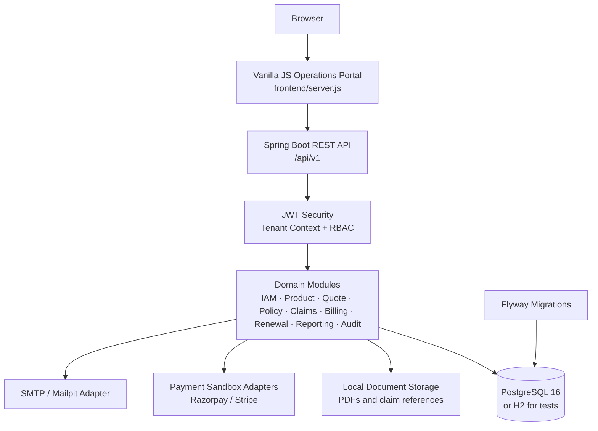

# InsureEase

## InsureGroup Management Platform

InsureEase is a multi-tenant SaaS platform for managing the complete group-insurance lifecycle. It supports Group Medical Coverage (`GMC`), Group Term Life (`GTL`), and Group Personal Accident (`GPA`) from employer onboarding and census pricing through underwriting, policy administration, claims settlement, billing, renewals, reporting, and audit.

The project is implemented as a Java 21 and Spring Boot 3.4 modular monolith with a PostgreSQL persistence layer and a browser-based operations portal. The current release is designed for an academic/internship demonstration using synthetic data and payment sandboxes.

> This repository is a prototype and demonstration platform. It must not be used with real personal, financial, or health data without completing a production security, privacy, regulatory, infrastructure, and operational review.

## Contents

- [Product Scope](#product-scope)
- [Core Capabilities](#core-capabilities)
- [Architecture](#architecture)
- [Technology Stack](#technology-stack)
- [Repository Structure](#repository-structure)
- [Prerequisites](#prerequisites)
- [Quick Start](#quick-start)
- [Application URLs](#application-urls)
- [Demo Accounts](#demo-accounts)
- [Frontend Navigation](#frontend-navigation)
- [API Overview](#api-overview)
- [Business Workflows](#business-workflows)
- [Domain Rules](#domain-rules)
- [Security and Multi-Tenancy](#security-and-multi-tenancy)
- [Data and Persistence](#data-and-persistence)
- [Configuration](#configuration)
- [Testing](#testing)
- [Operations and Troubleshooting](#operations-and-troubleshooting)
- [Project Status and Boundaries](#project-status-and-boundaries)
- [Academic and Product Context](#academic-and-product-context)

## Product Scope

### In scope

- Tenant onboarding and tenant-scoped data access
- JWT authentication, refresh tokens, RBAC, account lockout, and password reset APIs
- Product, plan, benefit, sub-limit, FCL, and versioned rate-table configuration
- Employer/policyholder KYC profiles
- CSV and JSON census upload with row-level validation
- Product-specific premium calculation for GMC, GTL, and GPA
- Automated underwriting referrals and maker-checker approvals
- Master policy issuance, members, dependents, nominees, certificates, and e-cards
- Mid-term endorsements with pro-rata premium and CD-wallet funding
- Claims intake, eligibility checks, documents, adjudication, and settlement records
- GST invoices, manual payments, sandbox payment orders, CD float, and ledger entries
- Experience-rated renewals and member rollover
- Reporting for dashboard, ICR/loss ratio, claims TAT, and SLA compliance
- Immutable audit events and DPDP consent records
- OpenAPI documentation and generated PDF documents

### Out of scope for this prototype

- Real insurer core-system integration
- Real hospital, TPA, KYC, or regulator integrations
- Live money movement; payment providers are sandbox adapters
- Retail/individual policies and reinsurance accounting
- Native mobile applications
- Production-grade object storage, malware scanning, Kafka/RabbitMQ deployment, or Kubernetes manifests
- Use of real personal or health information

## Core Capabilities

| Module | Package | Responsibility |
| --- | --- | --- |
| M1: Tenant and IAM | `com.insureease.iam` | Tenants, users, JWT login, refresh tokens, RBAC, account lockout, password reset |
| M2: Product and Rates | `com.insureease.product` | Products, plans, benefits, sub-limits, FCL, rate tables, underwriting rules |
| M3: Quotes and Underwriting | `com.insureease.quote` | Employer profiles, census validation, premium engine, quote versions, underwriting decisions |
| M4: Policy Administration | `com.insureease.policy` | Master policies, members, dependents, nominees, lifecycle, endorsements, PDF documents |
| M5: Renewals | `com.insureease.renewal` | ICR analysis, experience-rated renewal quotes, rollover, grace-period/lapse transitions |
| M6: Claims | `com.insureease.claims` | FNOL, eligibility chain, claim documents, benefit calculations, adjudication, settlements |
| M7: Billing and Payments | `com.insureease.billing` | GST invoices, payment orders, manual payments, CD float, refunds, double-entry ledger |
| M8: Notifications and Documents | `com.insureease.notification` | Event notifications and OpenPDF quote, policy, invoice, and e-card documents |
| M9: Reporting | `com.insureease.reporting` | Executive dashboard, ICR/loss ratio, claims TAT, IRDAI SLA metrics |
| M10: Audit and DPDP | `com.insureease.audit` | Immutable audit log, consent records, PII encryption/masking support |

## Architecture

InsureEase uses a modular-monolith architecture. All modules run in one Spring Boot application, but domain responsibilities are separated by package and controller/service/repository boundaries.



### Request flow

1. A user signs in through `POST /api/v1/auth/login`.
2. The API returns a short-lived JWT access token and a refresh token.
3. The frontend sends the access token as `Authorization: Bearer <token>`.
4. Spring Security resolves the user, tenant, and roles.
5. Services use the tenant context to scope reads, writes, audit events, and generated documents.
6. Domain services enforce business rules before persisting state changes.

### Architectural principles

- Controllers expose HTTP contracts and validate request DTOs.
- Services own domain behavior and business rules.
- Repositories encapsulate persistence access.
- Cross-module behavior is coordinated through service calls and domain events/application events where applicable.
- Every important mutation is audit logged.
- Documents are generated through the notification/document module.
- Payment providers are accessed through adapter-style integrations.

## Technology Stack

| Layer | Technology |
| --- | --- |
| Runtime | Java 21 |
| Backend | Spring Boot 3.4.3, Spring MVC |
| Persistence | Spring Data JPA, Hibernate, PostgreSQL 16 |
| Test database | H2 in-memory database |
| Migrations | Flyway |
| Security | Spring Security, JJWT, BCrypt password hashing |
| API documentation | Springdoc OpenAPI 3 / Swagger UI |
| Validation | Jakarta Bean Validation / Spring Validation |
| CSV processing | Apache Commons CSV |
| PDF generation | OpenPDF |
| Metrics | Spring Actuator, Micrometer Prometheus registry |
| Frontend | Vanilla JavaScript, HTML, CSS |
| Frontend server | Node.js static server with `/api` proxy |
| Local infrastructure | Docker Compose, PostgreSQL, Redis, MinIO, Mailpit |
| Payment integrations | Razorpay and Stripe sandbox adapters |

## Repository Structure

```text
InsureEase/
├── frontend/
│   ├── server.js                         # Frontend server and API proxy
│   └── public/
│       ├── index.html                     # SPA entry point
│       ├── app.js                         # Routes, state, views, API client
│       ├── styles.css                     # Product UI system and responsive styles
│       └── icons-and-cinema.js             # SVG icon registry and cinema scenes
├── src/main/java/com/insureease/
│   ├── audit/                             # Audit and DPDP consent
│   ├── billing/                           # Invoices, payments, CD, ledger
│   ├── claims/                            # Claims and adjudication
│   ├── common/                            # Exceptions, tenant context, seed data, crypto
│   ├── iam/                               # Tenants, users, authentication, JWT
│   ├── notification/                      # Notifications and PDF documents
│   ├── policy/                            # Policies, members, dependents, endorsements
│   ├── product/                           # Products, plans, benefits, rates, rules
│   ├── quote/                             # Employers, quotes, census, premium engine
│   ├── renewal/                           # Renewals and experience rating
│   └── reporting/                         # Dashboards and operational reports
├── src/main/resources/
│   ├── application.yml                    # Default H2/local configuration
│   ├── application-postgres.yml           # PostgreSQL profile
│   ├── db/migration/V1__init_insureease_schema.sql
│   └── static/                            # Frontend bundle served by Spring Boot
├── src/test/java/                         # Integration and business-rule tests
├── docker-compose.yml                     # Local infrastructure services
├── pom.xml                                # Maven build definition
├── PRD.md                                 # Product requirements document
└── README.md                              # This guide
```

## Prerequisites

- Java 21 or a compatible JDK
- Docker Desktop with Docker Compose
- Node.js 18 or newer
- macOS, Linux, or Windows with a POSIX-compatible Maven wrapper shell
- A browser such as Chrome, Edge, Firefox, or Safari

Verify the main tools:

```bash
java -version
docker --version
docker compose version
node --version
```

## Quick Start

### 1. Clone and enter the project

```bash
git clone https://github.com/NitinChugh13/InsureEase-InsureGroup-Management-Platform.git
cd InsureEase
```

### 2. Start local infrastructure

Start PostgreSQL for the normal application profile:

```bash
docker compose up -d postgres
```

Start the complete optional local stack if you need Redis, MinIO, or Mailpit:

```bash
docker compose up -d
```

PostgreSQL is exposed at `localhost:5433` on the host and uses:

```text
Database: insureease
Username: insureease
Password: insureease_secret
```

### 3. Run the backend

Open a terminal in the project root:

```bash
./mvnw spring-boot:run -Dspring-boot.run.profiles=postgres
```

On Windows, use `mvnw.cmd` instead of `./mvnw`.

The first startup runs Flyway migrations and seeds the `ACME-INSURE` demonstration tenant, products, plans, benefits, rate tables, employer, hospital, and demo users.

### 4. Run the frontend

Open a second terminal:

```bash
node frontend/server.js
```

Open the landing page at:

```text
http://localhost:5173/
```

The frontend server serves static assets and proxies `/api/*` requests to the Spring Boot backend at `http://127.0.0.1:8080`.

### 5. Run tests

```bash
./mvnw test
```

Tests use H2 and do not require PostgreSQL to be running.

## Application URLs

| Purpose | URL |
| --- | --- |
| Public landing page | [http://localhost:5173/](http://localhost:5173/) |
| Frontend operations dashboard | [http://localhost:5173/app/dashboard](http://localhost:5173/app/dashboard) |
| Backend root/static app | [http://localhost:8080/](http://localhost:8080/) |
| Swagger UI | [http://localhost:8080/swagger-ui/index.html#/](http://localhost:8080/swagger-ui/index.html#/) |
| OpenAPI JSON | [http://localhost:8080/v3/api-docs](http://localhost:8080/v3/api-docs) |
| Actuator health | [http://localhost:8080/actuator/health](http://localhost:8080/actuator/health) |
| MinIO API | [http://localhost:9000](http://localhost:9000) |
| MinIO console | [http://localhost:9001](http://localhost:9001) |
| Mailpit inbox | [http://localhost:8025](http://localhost:8025) |

The canonical API documentation URL is:

```text
http://localhost:8080/swagger-ui/index.html#/
```

## Demo Accounts

All demonstration users use tenant code `ACME-INSURE` and password `Admin@123`.

| Persona | Email | Main permissions |
| --- | --- | --- |
| Insurer Admin | `admin@acmeinsure.com` | Full tenant administration and all operational modules |
| Senior Underwriter | `underwriter@acmeinsure.com` | Quote review, underwriting decisions, maker-checker approvals |
| Senior Claims Officer | `adjudicator@acmeinsure.com` | Claim review, two-level adjudication, claim settlements |

The underwriter and claims-desk users are seeded idempotently. If the tenant already exists, application startup creates the missing accounts without recreating the tenant or business data.

For security, replace all demonstration credentials and secret values before using the system outside local development.

## Frontend Navigation

The frontend is a lightweight vanilla-JavaScript application with History API routing. It does not require a bundler or npm install for the current prototype.

### Public routes

| Route | Purpose |
| --- | --- |
| `/` | Product landing page and platform overview |
| `/how-it-works` | Guided lifecycle and process explanation |
| `/plans` | Product and plan comparison |
| `/quote-studio` | Guided quote-to-policy experience |
| `/login` | Tenant and persona-based sign-in |

### Authenticated routes

| Route | Purpose |
| --- | --- |
| `/app/dashboard` | Operations dashboard and work queues |
| `/app/products` | Products, plans, rates, benefits, and rules |
| `/app/quotes` | Employer directory and quote work queue |
| `/app/policies` | Policies, members, e-cards, and endorsements |
| `/app/claims` | Claim intake, review, adjudication, and settlement |
| `/app/billing` | Invoices, payments, CD float, and ledger |
| `/app/renewals` | ICR analytics and renewal rollover |
| `/app/audit` | Audit events and DPDP compliance records |

Unauthenticated users are redirected to the login view when they open an authenticated route. Successful login opens the operations dashboard.

## API Overview

All REST endpoints are versioned under `/api/v1`. Requests use `application/json` unless the endpoint explicitly accepts a multipart file. Authenticated requests require a JWT bearer token.

### Authentication and IAM

| Method | Endpoint | Purpose |
| --- | --- | --- |
| `POST` | `/api/v1/tenants` | Create a tenant and initial admin |
| `GET` | `/api/v1/tenants` | List tenants |
| `POST` | `/api/v1/auth/register` | Register a tenant user |
| `POST` | `/api/v1/auth/login` | Issue access and refresh tokens |
| `POST` | `/api/v1/auth/refresh` | Rotate a refresh token |
| `POST` | `/api/v1/auth/logout` | Revoke a refresh token |
| `POST` | `/api/v1/auth/password-reset` | Reset a password |
| `GET` | `/api/v1/users` | List tenant users |
| `GET` | `/api/v1/users/me` | Get the authenticated user |

### Product, plan, and rate configuration

| Method | Endpoint | Purpose |
| --- | --- | --- |
| `POST` | `/api/v1/products` | Create a product (`HEALTH`, `LIFE`, `PA`) |
| `GET` | `/api/v1/products` | List tenant products |
| `POST` | `/api/v1/products/{productId}/plans` | Create a plan |
| `GET` | `/api/v1/plans` | List plans, optionally by product |
| `GET` | `/api/v1/plans/{planId}` | Get plan details |
| `POST` | `/api/v1/plans/{planId}/benefits` | Add a benefit or sub-limit |
| `GET` | `/api/v1/plans/{planId}/benefits` | List plan benefits |
| `POST` | `/api/v1/plans/{planId}/rate-tables` | Create a versioned rate table |
| `GET` | `/api/v1/plans/{planId}/rate-rows` | List active rate rows |
| `POST` | `/api/v1/plans/{planId}/underwriting-rules` | Add an underwriting rule |
| `GET` | `/api/v1/plans/{planId}/underwriting-rules` | List underwriting rules |

### Employers, quotes, and underwriting

| Method | Endpoint | Purpose |
| --- | --- | --- |
| `POST` | `/api/v1/policyholders` | Create an employer/policyholder |
| `GET` | `/api/v1/policyholders` | List tenant employers |
| `POST` | `/api/v1/quotes` | Create a quote |
| `GET` | `/api/v1/quotes` | List quotes |
| `GET` | `/api/v1/quotes/{quoteId}` | Get quote details |
| `POST` | `/api/v1/quotes/{quoteId}/census` | Upload a JSON census |
| `POST` | `/api/v1/quotes/{quoteId}/census/csv` | Upload a CSV census file |
| `GET` | `/api/v1/quotes/{quoteId}/members` | List validated quote members |
| `POST` | `/api/v1/quotes/{quoteId}/calculate` | Calculate premium and evaluate rules |
| `POST` | `/api/v1/quotes/{quoteId}/decision` | Approve, reject, or counter-offer |
| `POST` | `/api/v1/quotes/{quoteId}/members/{quoteMemberId}/uw-decision` | Decide medical underwriting |
| `POST` | `/api/v1/quotes/{quoteId}/accept` | Accept an approved quote |
| `GET` | `/api/v1/quotes/{quoteId}/versions` | List quote versions |
| `GET` | `/api/v1/quotes/{quoteId}/proposal.pdf` | Download quote proposal PDF |

### Policy administration

| Method | Endpoint | Purpose |
| --- | --- | --- |
| `POST` | `/api/v1/policies` | Issue a policy from an accepted quote |
| `GET` | `/api/v1/policies` | List tenant policies |
| `GET` | `/api/v1/policies/{policyId}` | Get policy details |
| `GET` | `/api/v1/policies/{policyId}/members` | List policy members |
| `GET` | `/api/v1/members/{memberId}` | Get member details |
| `POST` | `/api/v1/policies/{policyId}/endorsements` | Submit an endorsement |
| `GET` | `/api/v1/policies/{policyId}/endorsements` | List endorsements |
| `POST` | `/api/v1/endorsements/{endorsementId}/approve` | Approve an endorsement |
| `POST` | `/api/v1/policies/{policyId}/lifecycle` | Move grace/lapse lifecycle state |
| `GET` | `/api/v1/policies/{policyId}/schedule.pdf` | Download policy schedule PDF |
| `GET` | `/api/v1/members/{memberId}/ecard.pdf` | Download member e-card PDF |

### Claims and hospitals

| Method | Endpoint | Purpose |
| --- | --- | --- |
| `POST` | `/api/v1/hospitals` | Register a hospital |
| `GET` | `/api/v1/hospitals` | List hospitals |
| `POST` | `/api/v1/claims` | Submit a claim |
| `GET` | `/api/v1/claims` | List claims, optionally by policy |
| `GET` | `/api/v1/claims/{claimId}` | Get claim details and history |
| `POST` | `/api/v1/claims/{claimId}/documents` | Register a claim document |
| `POST` | `/api/v1/claims/{claimId}/decision` | Query, approve, partially approve, or reject |

### Billing, payments, and ledger

| Method | Endpoint | Purpose |
| --- | --- | --- |
| `GET` | `/api/v1/invoices` | List invoices, optionally by policy |
| `GET` | `/api/v1/invoices/{invoiceId}` | Get invoice details |
| `POST` | `/api/v1/invoices/{invoiceId}/payment-orders` | Create a sandbox payment order |
| `POST` | `/api/v1/webhooks/payments/{provider}` | Receive a verified payment webhook |
| `POST` | `/api/v1/payments/manual` | Record a manual payment |
| `GET` | `/api/v1/policies/{policyId}/cd-account` | Get CD wallet and transactions |
| `POST` | `/api/v1/policies/{policyId}/cd-account/topup` | Top up a CD wallet |
| `GET` | `/api/v1/ledger-entries` | List accounting ledger entries |

### Renewals and reporting

| Method | Endpoint | Purpose |
| --- | --- | --- |
| `POST` | `/api/v1/policies/{policyId}/renewals` | Generate an experience-rated renewal |
| `GET` | `/api/v1/renewals` | List renewal cases |
| `POST` | `/api/v1/renewals/{renewalCaseId}/rollover` | Accept and roll over a renewal |
| `POST` | `/api/v1/policies/{policyId}/lifecycle` | Apply grace/lapse transitions |
| `GET` | `/api/v1/reports/dashboard` | Executive dashboard metrics |
| `GET` | `/api/v1/reports/loss-ratio` | Portfolio and policy ICR report |
| `GET` | `/api/v1/reports/claims-tat` | Claims TAT and SLA report |

### Audit and DPDP consent

| Method | Endpoint | Purpose |
| --- | --- | --- |
| `GET` | `/api/v1/audit-logs` | Query immutable tenant audit events |
| `POST` | `/api/v1/dpdp/consents` | Record consent or revocation |
| `GET` | `/api/v1/dpdp/consents/{memberId}` | List member consent records |

The complete request and response schemas are available in [Swagger UI](http://localhost:8080/swagger-ui/index.html#/).

## Business Workflows

### Quote to policy

1. Create an employer profile.
2. Create a quote linked to a plan.
3. Upload a CSV or JSON census.
4. Review row-level validation results.
5. Calculate member and aggregate premiums.
6. Apply automated underwriting rules.
7. Approve, reject, or counter-offer the quote.
8. Accept the approved quote.
9. Issue a policy in `PENDING_PAYMENT` state.
10. Generate and pay the initial invoice.
11. Activate the policy and enrol members.

### Policy administration

Policies contain enrolled members and, where applicable, dependents and nominees. Policy officers can download the policy schedule and member e-cards, submit additions/removals or corrections as endorsements, and approve endorsement premium changes through the CD wallet or invoice flow.

### Claims

1. Submit a cashless, reimbursement, death-benefit, or disability-benefit claim.
2. Run policy, member, waiting-period, and sum-insured eligibility checks.
3. Register required documents.
4. Route the claim to an adjudicator.
5. Query, approve, partially approve, or reject with reason codes.
6. Apply co-pay, deductibles, sub-limits, non-payables, or product benefit percentages.
7. Create a settlement and corresponding ledger entry.

### Renewals

1. Select an active policy approaching expiry.
2. Calculate earned premium, incurred claims, claim frequency, and ICR.
3. Apply the configurable experience-rating curve.
4. Review the renewal quote.
5. Accept and roll over active members into a new policy term.

## Domain Rules

| Rule | Behavior |
| --- | --- |
| Premium | Base rate and SI factors are adjusted by loadings/discounts and GST |
| Endorsement premium | Annual premium multiplied by remaining days divided by policy days |
| Waiting period | New member waiting periods begin on the member cover start date |
| Claim eligibility | Policy must be active or within an eligible grace period with premium paid |
| Sum insured | Claim payable amount cannot exceed remaining individual or floater SI |
| Dependents | Relation type and age must satisfy plan configuration |
| Renewal ICR | Under 60%: -5%; 60-80%: 0%; 80-100%: +10%; over 100%: +20% |
| Grace period | Default policy grace period is 30 days |
| Maker-checker | High SI, premium, or discount decisions require senior underwriting approval |
| Claims approval | Claims above the configured threshold require two-level approval |
| GTL FCL | Cover above the configured Free Cover Limit is referred for medical underwriting |

Thresholds are configured in `application.yml` and can be externalized through environment variables or a deployment configuration system.

## Security and Multi-Tenancy

### Authentication

- JWT access tokens expire after 15 minutes by default.
- Refresh tokens expire after 7 days by default and are rotated/revoked by the IAM service.
- Passwords are stored as BCrypt hashes.
- Failed-login tracking supports temporary account lockout.
- All protected APIs require a bearer token.

### Authorization

The platform supports role-oriented access for:

- Platform administrator
- Insurer administrator
- Underwriter and senior underwriter
- Policy administrator
- Claims officer and senior claims officer
- Finance officer
- Broker/agent
- Employer HR administrator
- Member
- Auditor/compliance user

### Tenant isolation

Tenant identity is resolved from the authenticated user and propagated through `TenantContext`. Domain repositories and services scope business data by tenant. Audit events include tenant, actor, entity, action, and request context.

### Sensitive data

The design supports AES-256-GCM encryption for restricted PII, masking in responses/logs, consent tracking, and append-only audit records. Local demo keys and sandbox secrets in configuration are placeholders and must be replaced in any real deployment.

## Data and Persistence

The database schema is initialized by Flyway migration:

```text
src/main/resources/db/migration/V1__init_insureease_schema.sql
```

Important aggregate areas include:

- `tenant`, `app_user`, roles, permissions, and refresh tokens
- `product`, `plan`, benefits, rate tables, rate rows, and underwriting rules
- `policyholder`, `quote`, quote members, and quote versions
- `master_policy`, members, dependents, nominees, endorsements, and renewal cases
- `claim`, claim documents, claim events, and settlements
- `invoice`, payments, CD accounts, CD transactions, and ledger entries
- hospitals, notifications, audit logs, and consent records

The default test profile uses H2 in-memory storage. The `postgres` profile uses PostgreSQL 16 through Docker Compose.

## Configuration

The default local configuration is in `src/main/resources/application.yml`. PostgreSQL overrides are in `application-postgres.yml`.

Common environment variables:

| Variable | Purpose | Default/local value |
| --- | --- | --- |
| `PORT` | Spring Boot HTTP port | `8080` |
| `DB_URL` | JDBC connection URL | H2 in-memory URL |
| `DB_USERNAME` | Database user | `insureease` |
| `DB_PASSWORD` | Database password | `insureease_secret` |
| `DB_DRIVER` | JDBC driver | `org.h2.Driver` |
| `JWT_SECRET` | JWT signing secret | Development placeholder |
| `PII_AES_KEY` | AES-256 encryption key | Development placeholder |
| `SEED_DEMO_DATA` | Enable demo seed data | `true` |
| `STORAGE_DIR` | Local document storage directory | `./target/insureease-storage` |
| `RAZORPAY_KEY_ID` | Razorpay sandbox key | Development placeholder |
| `RAZORPAY_KEY_SECRET` | Razorpay sandbox secret | Development placeholder |
| `RAZORPAY_WEBHOOK_SECRET` | Razorpay webhook secret | Development placeholder |
| `STRIPE_API_KEY` | Stripe sandbox key | Development placeholder |
| `STRIPE_WEBHOOK_SECRET` | Stripe webhook secret | Development placeholder |

Example PostgreSQL configuration:

```bash
export DB_URL='jdbc:postgresql://localhost:5433/insureease'
export DB_USERNAME='insureease'
export DB_PASSWORD='insureease_secret'
export DB_DRIVER='org.postgresql.Driver'
export JWT_SECRET='replace-with-a-long-random-secret'
export PII_AES_KEY='replace-with-a-32-byte-key'
```

Never commit production secrets, payment keys, encryption keys, or real personal data.

## Testing

Run the complete suite:

```bash
./mvnw test
```

The test suite currently covers:

- Group Health quote, policy, payment, and claims lifecycle
- Group Term Life FCL and nominee death claim flow
- Group Personal Accident disability-scale calculations
- Tenant isolation and audit events
- Grace-period claim behavior
- CSV census validation, PDF generation, and DPDP consent
- Maker-checker and two-level claim approval rules

Useful verification commands:

```bash
# Compile without running tests
./mvnw -DskipTests compile

# Check the frontend JavaScript
node --check frontend/public/app.js

# Verify the frontend proxy and history fallback
curl -I http://localhost:5173/
curl -I http://localhost:5173/app/dashboard

# Verify backend health
curl http://localhost:8080/actuator/health
```

## Operations and Troubleshooting

### PostgreSQL is not ready

Check the container and health status:

```bash
docker compose ps
docker compose logs postgres
```

Restart only PostgreSQL if needed:

```bash
docker compose restart postgres
```

### Port already in use

The standard ports are:

- Frontend: `5173`
- Backend: `8080`
- PostgreSQL: `5433`
- Redis: `6379`
- MinIO: `9000` and `9001`
- Mailpit: `8025` and `1025`

Change `PORT` for Spring Boot or `PORT`/`BACKEND_PORT` for `frontend/server.js` when running multiple instances.

### Demo login fails

Ensure the backend has been restarted after changing seed code. The seed initializer creates missing demo personas only when the application starts. Confirm the tenant code is exactly:

```text
ACME-INSURE
```

If a user has been locked after repeated failed attempts, wait for the lockout period or reset the local database volume in a disposable development environment.

### Reset local PostgreSQL data

This deletes all local database data and should only be used for development:

```bash
docker compose down -v
docker compose up -d postgres
```

### Frontend API proxy errors

Confirm Spring Boot is running on port `8080`. The frontend proxy reports a `502 Backend Unavailable` response when it cannot reach the backend.

## Project Status and Boundaries

Implemented in the current platform:

- Backend modules M1-M10 and their REST controllers
- PostgreSQL/H2 persistence and Flyway schema migration
- Seeded multi-product data for GMC, GTL, and GPA
- JWT/RBAC authentication and demo personas
- Operations frontend with public landing pages and authenticated workspace routes
- OpenAPI/Swagger documentation
- Automated integration and business-rule tests

Prototype boundaries that require further production work:

- Replace demo secrets and credentials with managed secrets/vault integration.
- Add production database backups, HA, monitoring, alerting, and deployment manifests.
- Complete object-storage upload, antivirus scanning, and retention workflows.
- Integrate real hospital/TPA/KYC/notification providers through production adapters.
- Add robust XLSX support if spreadsheet upload is required beyond CSV.
- Complete production-grade audit immutability, key management, and DPDP operational procedures.
- Add dedicated end-to-end browser tests and load tests for 5,000-member census processing.

## Academic and Product Context

InsureEase is intended to demonstrate a complete group-insurance system design for a B.Tech/HCLTech internship project. The full product requirements, business rules, personas, ERD/HLD/LLD direction, delivery plan, risks, and acceptance criteria are documented in [PRD.md](PRD.md).

The platform is designed around the following measurable goals:

- Validate and load a 5,000-member census in under two minutes in an appropriately provisioned environment.
- Match reference rate-card calculations across GMC, GTL, and GPA.
- Reduce simulated claims turnaround time through automated eligibility and structured adjudication.
- Generate experience-rated renewals before policy expiry.
- Capture all important state changes in the audit trail.
- Maintain tenant isolation and role-appropriate access.

## License and Usage

This repository is an academic/internship project. Add an explicit license before distributing it as reusable software. Do not use the seeded credentials, default encryption keys, or sandbox payment configuration in production.

